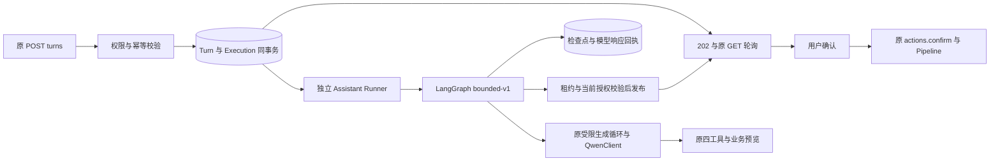

# AI 助手 LangGraph 接入进度

2026-10-22：正式异步 Runner、原子入队和既有 API 接入已实现并在本地隔离环境验收，**尚未部署**。
新请求默认后端仍为 `legacy`；管理员在部署并确认 Runner 可用后设置 `DATA_PLATFORM_AI_BACKEND=langgraph`。
客户端不能选择后端、模型、执行身份或批准标记。

## 请求与执行



`AssistantService._reserve` 在原调度锁事务中创建 Turn、会话 revision、审计和 execution。
原请求摘要继续用于重复请求识别；新记录保存 owner、request/conversation、模型与 backend/graph/schema 版本。
重复 POST 只返回原状态，跨 backend 切换也不重新入队或同步执行。用户 1、全局 4 的并发限制仍按同一 Turn 集合统计，
排队请求占额度；生成完成释放额度，操作卡片等确认和业务 Job 不占生成额度。

`runner.py` 是独立入口，默认 4 个线程，读取共享数据库，不启动 Flask 注册表和缓存。
它只领取支持的 `bounded-v1` / state 1 执行；每 5 秒续租，租约 30 秒。
所有检查点、pending writes、模型回执与最终发布均在数据库锁内校验租约持有者和 epoch。
最终结果、会话历史、execution 终态和审计在同一事务发布；旧进程无法覆盖新持有者。
发布前还检查账号/对象权限、当前数据身份和会话 revision，Viewer 仍不能得到可执行操作卡片。

## 恢复策略与边界

一期将原有四工具生成循环作为一个图节点，保留其参数校验、修复策略、脱敏和上下文限制，避免一次重写全部行为。
不是每个工具都有独立 checkpoint。节点重放时重新加载授权上下文并重新验证只读/准备工具；
每次 Qwen 请求有独立的持久回执，只有完整请求摘要相同才复用响应。
上下文变化则结束请求并要求用户重试；没有持久响应的已预留请求标为 outcome unknown，不自动再次发送。
不承诺 provider exactly-once，也不尝试用新的 call ID 绕过未知结果。

沿用每次最多 8 个模型调用、每轮最多 4 个工具、单请求最多 2500 输出 tokens 和最长 15 秒 HTTP 超时。
次数在发送前持久预留，恢复不会重置；120 秒排队截止与首次领取后 75 秒生成截止分别管理。
75 秒采用保守墙钟时间，包含停机/恢复时间，不是扣除停机的有效运行计时。
预算在模型和每个工具前检查，完整节点及结果发布时再次检查。等待用户或 Job 不放在生成图内。

确认仍只有原 `actions.confirm`：模型工具集没有确认或执行工具，卡片按原 action ID、revision 和输入身份提交。
已有 delivery 幂等、权限撤销、源身份变化、旧卡片失效以及重复确认恢复逻辑不变。

## 存储与运行

正式新增表使用 `dp_ai_runtime_` 前缀：`executions`、`calls`、`checkpoints`、`writes`。
通过原 `migrate_management()` 进行加表，原表和 JSON API 字段不变；兼容现有 schema 6 读者。
保留现有 30 天增量清理规则，清理 Turn/会话时一起清理其运行数据；不会删除活跃请求。
不调用实验目录的 `setup()`，也不复用实验 `dp_ai_executions` 表。

正式 saver 基于 LangGraph `BaseCheckpointSaver`，使用平台 SQLAlchemy 事务，支持 MySQL 和 SQLite。
它保存有大小上限的完整检查点并启用严格反序列化，只支持当前 execution 的 root graph；不提供无范围查询或删除接口。
这个选择保留已验证的租约事务约束，同时避免正式控制事务依赖社区 saver 的私有 `_cursor` 钩子。
依赖锁定 LangGraph 1.2.16 / checkpoint 4.3.0，记录在 Server extra 和 `uv.lock`；节点 Agent 不需要这些依赖。
图执行显式关闭 LangSmith tracing，不因进程环境变量开启而向第三方导出私有会话或检查点内容。

发布脚本生成 `data-platform-assistant@<env>.service`，使用发行目录内固定的代码和解释器，读取同一受保护环境配置。
SIGTERM 停止领取新工作，等待当前有预算的生成退出；systemd 最长等待 100 秒。
切换回 legacy 默认值时保留 Runner，让已接收图请求结束。回滚到不含 Runner 的旧发行包前应先排空图请求；
正常安装脚本会停止并禁用不再存在的 Runner unit，未完成的遗留 Turn 最终按旧超时语义结束。
图语义或状态格式不兼容时必须更新版本并制定兼容/排空步骤，不能假定新 Runner 可恢复任意旧状态。

## 验收与后续

- 助手、权限、上下文、个人偏好、CLI 和发布流程综合回归 256 项通过；发布兼容测试单独复跑 88 项通过。
- SQLite 异步接入 13 项通过；Python 3.10 + MySQL 8.0.46 使用真实业务表与检查点表同样 13 项通过。
- 覆盖原子接入回滚、8 个并发领取者、旧 epoch 拒写、事务过期回滚、未知模型结果、响应回执恢复、
  检查点完成后的跨进程发布、权限/身份/revision 变化、固定图版本、共享配额和显式幂等确认。
- 浏览器实测 POST 202、刷新恢复 pending、轮询完成和明确确认后唯一提交；CLI 在真实本地 HTTPS/CSRF 下
  对 legacy、langgraph 均验证聊天、恢复、偏好、确认和退出。Qwen 使用可控模拟响应，没有线上模型调用或数据任务。
- Server、Agent、CLI 未部署；浏览器验收是私有本地 fixture，不是 dev/prod 在线验收。

隔离 MySQL 一键复现：

```bash
.venv/bin/python -m experiments.assistant_langgraph.run_acceptance --runtime
```

新旧源码的行为回归与浏览器用例已进入发行检查；实际开发部署仍需当前环境验收，生产提升仍需批准。
配套 CLI 0.3.5 保留原异步轮询、`/resume` 和显式确认契约，同时兼容 V0.3.5 legacy。
发行时先校验版本化安装器、wheel 与 CA、开发和生产登录及 `/open`，再推进 latest；实际身份和结果保存在发行验收记录中。
## 后续源码阶段：显式记忆与任务跟进

后台经验增强使用独立进程和可重建 SQL 缓存，交互 Runner 不调用 Hindsight。来源摘要和记忆 revision
在每次模型调用前后重验；规则变更或来源失效终止旧回答。时延、租约、删除、回退与验收契约见
[后台经验归纳](data_platform_hindsight.md)。原始 mem0/显式记忆不被此增强替换。

长期记忆保存在独立的 `dp_ai_memory`，不依赖 LangGraph 短期检查点；用户通过网页/CLI 显式修改，
每轮读取当前授权的有界笔记，不从聊天自动学习。既有偏好、工具白名单和确认契约保持不变。
`dp_ai_followups` 在确认回执事务内按 action ID 登记，由 Runner 的独立 SQL 观察循环生成终态总结；
原子发布、既有审计、跨进程恢复和读取时权限重查覆盖重复执行及访问撤销。总结不修改会话 revision，
后续模型请求可读取该会话最近三条事实摘要。状态改变导致恢复时上下文不同时，仍按既有 replay guard 拒绝重放。
具体上限、30 天总结保留、停用/回滚和未覆盖任务见[运维契约](data_platform_operations.md)。
`--runtime` 私有 MySQL 验收同时覆盖新记忆/跟进模块；真实浏览器发布门禁包含 Memory CRUD 和断开后只读总结。
此阶段为未发布源码，实际 Server/Runner 与 CLI 发布及在线验证仍需独立完成。
