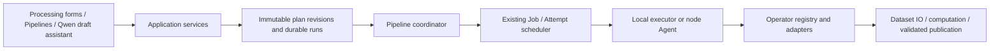

# Unified operators and sequential pipelines

This implementation builds on platform source `ce6e2680` and the installed `.60` release. It absorbs
algorithm ideas from `data_laundry` commit `6ba72ff6ca4ccb143eeeb15bcafd3047aac14845` through the platform's
existing dataset, review and publication contracts. Runtime acceptance and installed release identity
must be checked separately from this source baseline.

## Boundaries

The existing control plane owns authentication, dataset scopes, Job/Attempt admission, quotas, path locks,
stop confirmation and immutable release installation. `processing/` owns saved plans and orchestration;
`operators/` owns computation descriptions and dispatch. `TaskCatalog` continues to describe robot tasks.
Pipeline steps run sequentially on one node. Dataset inputs may reference earlier dataset outputs;
evidence references do not replace the dataset input. Source mutations use their dedicated guarded forms. A confirmed, registered local dataset output
is added to that executor's read configuration before downstream work; its writable roots and mutation
switches remain unchanged. A directory selection cannot grant this derived-output permission. Remote dataset outputs must remain
inside the node's configured read roots; preview rejects an incompatible output location.



Source-loss cleanup is independent of operator execution: authoritative Agent checks retire a missing
input and its owned caches while preserving Job/Attempt history, lineage and independent outputs.
Queued dependent work is cancelled; running/interrupted work retains cache protection. Pipeline preview,
submission and scheduler claims reject retired inputs. See [storage](data_platform_storage_locations.md)
for cleanup ownership and retry rules. Curation-backed repair review retains the existing unrestricted
Curation access requirement even when submitted through a pipeline.

## Qwen draft assistant

Open **Preprocessing → Pipeline** (also `/pipelines`) and describe a workflow. The sequential graph
supports insertion, removal, drag/keyboard reordering and a selected-node parameter inspector. Input and
evidence references must precede their users; referenced nodes cannot be silently removed. AI drafts
show changes before application and support undo. **Validate and run** previews the target and outputs;
**Confirm run** saves a version and submits through the existing authorized, idempotent service.

The assistant feeds structured blockers back to the model and revalidates repairs, with at most three
correction attempts. A deterministic draft-only rule inserts or moves an unambiguous source Snapshot before
its users, then revalidates it. It also corrects dataset inputs that mistakenly reference a preceding source
Snapshot: Snapshot binds identity, while subsequent reads still use `source`. Derived or forward references
are not guessed. Other blockers return to the model. It reuses Snapshot/evidence producers and cannot remove requested steps, alter their
parameters or bypass review while repairing prerequisites. Ambiguous choices require user input.
Blocked drafts remain visible with step ID, position, operator, code, reason and suggested remedy.
Strict save/run validation is unchanged; parser diagnostics are structured in preview only.

Dataset, published Quality-report and Jobs entries open `/assistant` with a typed target. These share the
same conversation service, bounded context readers and evidence links. Viewer accounts may ask read-only
questions; only operation roles receive editable drafts and preparation cards. Actual retry/review/run
operations remain in their existing interfaces. Job context retains the normal owner/admin visibility rule.

The first version uses the platform's server-configured Qwen account; users do not supply API keys.
It supports one selected dataset and up to 12 steps, without additional source-location or lifecycle
options. Existing manual forms remain available for those operations. The model has only
`read_context`, `describe_operator` and `preview_pipeline` tools; it cannot submit Jobs, save pipelines, approve review,
delete data or publish outputs. Existing Pipeline authorization applies when the user later saves/runs.

Requests include the user's text, recent conversation, the last validated draft, operator descriptions,
selected dataset counts plus at most 40 field schemas, and sanitized Quality/task summaries. Context
results are capped at 20 KiB each and 60 KiB cumulatively, with at most 20 anomaly examples or task events.
Legacy report reads stop at 256 KiB and report unavailability rather than reading an entire large artifact.
Raw rows, images, videos, full logs and filesystem paths are not automatically sent. Avoid entering secrets or sensitive data in prompts. The chosen Qwen endpoint receives
this context, so configure a suitable region/provider policy for the installation.

Conversations are private to the account, environment, dataset and typed target. Jobs bind Attempt identity; Quality binds version and report fingerprints. The browser remembers the current
conversation per account/location for the tab session; the control database retains the last six exchanges
and last validated draft. **New chat** starts a separate conversation. Reloading restores a pending request
by ID; a disconnected browser does not automatically cause a second billable call. If the registered input
identity changes, start a new chat. Dataset/account switches discard stale UI responses.

The assistant permits one active request per user, four across Server A, and 20 requests per user per hour.
Each request has at most eight model calls, four tool calls per response, and 2,500 output tokens per model
call. The generation budget is 75 seconds; HTTP timeouts are at most 15 seconds and capped by remaining time. Abandoned requests expire after 120 seconds and late
results cannot overwrite newer state. Failed accepted requests also count toward the hourly quota.
Conversations inactive for 30 days and completed request receipts older than 30 days are incrementally
removed on new admissions (up to 100 of each per admission); backups follow the database's retention policy.
Audit events contain request identity, model, status and token usage, without conversation text.

Authenticated API:

- `GET /api/ai-assistant/capabilities`: availability and server model; never the API key.
- `POST /api/ai-assistant/turns`: `request_id` and `conversation_id` UUIDs, `expected_revision` (0 for a
  new conversation), `location_id`, optional `context: {type, target_id}` (`pipeline`, `dataset`, `quality`, `job`), optional current editor `draft` (up to 12 single-input steps), and a `message` of up to 3,000 characters. Send JSON with a positive
  `Content-Length`, at most 16 KiB; streaming/chunked bodies are not accepted.
- `GET /api/ai-assistant/turns/{request_id}`: idempotent request recovery.
- `GET /api/ai-assistant/conversations/{conversation_id}`: authorized bounded history, revision and draft.

Repeated identical request IDs reuse the result; changed content with the same ID returns 409.
Model/endpoint/key overrides from the browser are rejected. Omitted context remains a Pipeline conversation for backward compatibility. Evidence links and typed navigation/preparation cards are generated by the server, never arbitrary model URLs. Viewer tool calls are restricted on the server as well as in the UI.

## Operator contract

`OperatorSpec` pins an ID and implementation version, parameter schema, dataset formats, dependencies,
read/write effect, output type, resources, cancellation/checkpoint support and compatibility entry points.
Discovery reads Python signatures through AST; it does not import models or initialize GPUs. Schemas
support JSON scalar/object/array types, required fields, defaults, item schemas, enums and numeric bounds.
Algorithm-specific validation remains authoritative. Missing backend/dependency and node-version reasons
are exposed in discovery and preview; capability heartbeats contain descriptions, not reports.

`ExecutionContext` provides registered source/output roots, an attempt working directory, bounded resource
allocation, artifact files, progress and cancellation callbacks. Computations run without Flask request
state. Existing builtins retain their specialized publication/checkpoint adapters. New operators normally
need only an implementation accepting `(context, parameters)`, a descriptor in the trusted registry and
contract tests. They return `OperatorResult(summary, artifacts, derived_datasets, episode_lineage)`.
Artifact paths are relative to the working directory. A dataset producer must return its declared output,
pass full dataset validation and provide lineage when episode identity/cardinality changes. There is no
HTTP-uploaded Python code or arbitrary callable execution interface.

Register only trusted implementation code installed with the release. Declare `required_modules` for
optional dependencies and bump the operator version when behavior changes. Keep existing versions while
queued/running snapshots need them; an Agent with a different advertised version cannot claim that job.

## APIs and saved plans

All endpoints require the existing session authentication and current dataset scope. Viewer accounts
may inspect capabilities; they cannot save, run or decide. Saved configurations/runs are private to their
owner. Lists are capped (200 definitions, 100 run summaries); reports remain in separate artifact routes.

| Endpoint | Contract |
| --- | --- |
| `GET /api/operators[?location_id=…]`, `GET /api/operators/{id}` | Schema and target availability |
| `POST /api/processing/preview` | `{location_id, definition}`; normalized/pinned steps, output templates and blocking reasons |
| `GET/POST /api/pipelines` | List / save `{definition}` as revision 1 |
| `GET/PUT /api/pipelines/{id}` | Read latest or `?revision=…`; save `{definition, expected_revision}` |
| `POST /api/pipelines/{id}/runs` | `{revision, location_id}` plus required `Idempotency-Key` |
| `GET /api/pipeline-runs[?location_id=…]` | Bounded run summaries |
| `GET /api/pipeline-runs/{id}` | Revision, status, step Job IDs, input/output locations and decisions |
| `POST /api/pipeline-runs/{id}/decisions` | `{expected_revision, step_id, decision: approve\|skip}`; pose repair also needs `workspace_id, workspace_revision` |
| `POST /api/pipeline-runs/{id}/cancel` or `/retry` | `{expected_revision}`; reuse existing Job commands |
| `GET /api/operator-results/{job_id}/{path}` | Owner/scoped access to published generic operator artifacts |

Example definition (parameter defaults and operator versions are resolved when saved):

```json
{
  "schema_version": 1,
  "name": "Snapshot, subset and inspect",
  "steps": [
    {"step_id": "snapshot", "operator_id": "curation.snapshot"},
    {"step_id": "subset", "operator_id": "preprocess.split", "parameters": {"episode_range": "0:20"}},
    {"step_id": "quality", "operator_id": "curation.quality", "input": "subset", "parameters": {"checks": ["s3", "c3"]}}
  ]
}
```

A source version must be synchronized first (include Snapshot as the first step). Secondary Merge or
Subtract inputs use registered `options.source_location_ids`; every input must be authorized, synchronized
and on the same node. Paths cannot be injected as algorithm parameters. Existing model trial options,
output variants, explicit signal selection and MCAP config/checkpoints retain their original contracts.
Project requires an earlier Embedding artifact; Construction requires Labeling evidence. Dependency steps
must be explicit in the saved sequence; preview reports missing evidence instead of silently inserting work.

## Durability, review and recovery

The management database adds `dp_pipelines`, `dp_pipeline_versions`, `dp_pipeline_runs` and
`dp_pipeline_steps`. Published plan revisions are immutable; edits use optimistic locking. A shared
scheduler transaction and unique constraints link each step to at most one Job. The coordinator polls
bounded pages and can restart or run concurrently without duplicating submissions. It pauses during
maintenance. It launches downstream work only after publication and control-plane acknowledgement.

Public run states are `queued`, `running`, `waiting_review`, `done`, `error`, `cancel_requested` and
`cancelled`; `retry_requested` is durable pending command delivery. Waiting for review creates no Job and
uses no compute slot. Decisions bind run revision, data identity, proposed parameters and evidence Job IDs.
Pose repair additionally binds the exact Curation repair draft and revision; edits to that draft invalidate
approval. Skip passes through the dataset input for a dataset-producing step.

Cancel intent is persisted before Job commands are sent and is replayed after a coordinator restart. A
running pipeline stays cancelling until the executor confirms exit. Retry uses the failed Job's existing
retry command and preserves completed, acknowledged outputs. Existing supervisor result/upload replay
continues to handle publication failure without recomputing completed work; MCAP automatic recovery keeps
its separate, bounded process-loss rules. Validated preprocessing outputs have a command/input/output fingerprint checkpoint, so a failed version
registration can resume publication without rerunning the transform. Operator snapshots include resolved parameters, versions,
input fingerprints and artifact checksums. Execution snapshots use the selected registered replica root,
including secondary inputs; another replica of the same logical version does not change immutable version identity. After atomic dataset publication, spooled snapshot/result paths
are rebased to the final output and the bundle checksums are regenerated. Retained older executors may
finish with their exact authenticated attempt staging path; registration also requires confirmation of
the planned final output and matching metadata. Fingerprints are checked again before dataset computation.

## Laundry absorption

- `curation.quality` / EEF keeps `dataset_quantile` as its original default. Optional
  `qc_config.eef.strategy="laundry_spike"` uses the laundry spike strategy and requires explicit position
  units (`m`, `cm`, `mm`). Reports record strategy, thresholds, units and provenance.
- Existing C3 black-frame detection retains platform sampling/full-scan, image/video adapters and review
  evidence. No second black-frame detector or automatic episode deletion is introduced.
- `preprocess.pose_interpolate` accepts explicit half-open `[start_frame,end_frame)` intervals with a
  preceding and following anchor. It uses linear position interpolation and quaternion SLERP. Pose field
  names or explicit indices, quaternion order and position units are required; unknown layouts fail.
- Repair runs require matching Quality evidence and an approved Curation draft containing the exact
  proposed intervals. The Review repair form supports pose definitions. Published Manifest repair recipes
  bind stable episode UIDs, so later episode reindexing does not change their target.
- Repair always writes a fresh sibling dataset through staging/validation/atomic rename, retains unrelated
  columns and episodes (including shared v3 shards), refreshes statistics and registers lineage. Existing
  output reuse is rejected; data/metadata symlinks that could escape output boundaries are rejected.
  This avoids laundry's pending-decision resume and hard-link overwrite failure paths.

## Console service and page boundaries

The legacy API and CLI contracts remain in place. `services/catalog.py` owns dataset registration,
loading, persisted registry state and publication callbacks; `services/cache.py` owns cache summaries,
metadata/video inventory and invalidation; `services/presentation.py` owns the existing dataset response
and navigation shapes. They share one `ConsoleState` and the existing `RouteContext` references.
`processing/console_submissions.py` accepts parsed legacy request payloads and owns their scheduling and
worker result handling. `routes/console_datasets.py` and `routes/console_jobs.py` preserve the original
paths and endpoint names, so authorization, audit and the local executor keep their existing contracts.
`viewer.py` assembles these services and retains episode rendering and the dedicated guarded annotation
and source-edit workflows. Its remaining size does not indicate a second registry or submission service.

The homepage composes `templates/console/` modules for navigation, accounts, dataset browsing, operator
forms, lifecycle records and run tracking. Each module creates its own state per console instance;
composition rejects duplicate property owners. Existing bindings call the composed Alpine facade.
Operator panels are Jinja includes, with no frontend build requirement. Read results are scoped to their
account/environment and applicable dataset or browsing revision; superseded responses cannot replace the
current selection's data or errors.

`Preprocessing > Pipeline` and `/pipelines` mount the same editor. The embedded editor uses an isolated
DOM/style root; switching its dataset/account or leaving the view disposes requests and polling. Accepted
Jobs continue through the scheduler. Saving creates an immutable version as before.

See [architecture completion review](data_platform_architecture_review.md) for requirement-level evidence
and the distinction between implementation, runtime acceptance and production promotion.

## Compatibility and migration inventory

The table below accounts for the existing computation families. Original route paths, CLI flags, defaults,
source mutation guards and result protocols remain supported. Local ordinary background routes serialize
allowlisted domain commands instead of replaying HTTP requests or extracting function closures. Protected
source mutation, ledger publication and cache-maintenance compatibility paths remain explicit; immediate synchronous reads
retain their existing bounded handlers.

| Existing entry family | Canonical operators / adapter | Execution and effect |
| --- | --- | --- |
| Preprocess API/CLI: dimensions, format, fields, smoothing, values | `preprocess.convert_action`, `convert_v3`, `drop_field`, `smooth_action`, `value_edit` | Unified dispatch; derived dataset |
| Standardization and optional episode removal | `preprocess.standardize` | Existing composite adapter preserves source/output cache phases |
| Split / Merge / Subtract | `preprocess.split`, `merge`, `subtract` | Registered inputs, sibling outputs and explicit lineage |
| Stage/height alignment and trajectory cleanup | `preprocess.stage_return_alignment`, `stage_return_height_alignment`, `trajectory_cleanup` | Unified adapters; original applicability and dry-run defaults |
| Legacy quality / flag clearing | `preprocess.quality_flags`, `preprocess.clear_flags`; `curation.quality` for versioned chains | Cache evidence; legacy flag clearing stays dedicated |
| Legacy flag fixes and prompt rewriting | `preprocess.flag_fixes`, `rewrite_prompts`, `fix_prompt_prepositions`, `lowercase_prompts` | Source-effect descriptors; dedicated protected compatibility adapters |
| Labeling / Tagging / Embedding | `curation.labeling`, `tagging`, `embedding` | Model backends, trial and credential isolation preserved |
| Projection / comparison / construction preview | `curation.project`, `compare_summary`, `construction_preview` | Existing artifact adapters; explicit evidence references |
| Construction | `curation.construction` | Validated derived output and Curation publication |
| Snapshot / source validation / stage / Manifest materialization | `curation.snapshot`, `validate_source`, `stage`, `materialize` | Existing immutable lifecycle contracts |
| Temporal Caption | `caption.annotate` | Existing episode/scheme/signal and result-sync protocol |
| Viewer precompute | `viewer.prepare` | Existing atomic cache publication and source protection |
| MCAP inspection / conversion | `import.mcap.inspect`, `import.mcap.convert` | Existing config, checkpoint, conversion and publication adapters |
| Trim / episode deletion / timestamp repair / in-place values | `mutation.trim_episode`, `delete_episodes`, `repair_v3_video_timestamps`, `value_edit` | Privileged legacy entry points, excluded from chains |
| Local prompt assignments / prompt source fixes | `preprocess.apply_prompt_assignments` and `mutation.*` aliases | Cache versus source guards retained |
| Task mapping cache / analysis / Inspect | `task_mapping_cache`, `analysis`, `inspect` | Explicit bounded/local compatibility entries; not automatic chains |
| Two-dataset comparison / task suggestions | `compare.build`, `tasks.suggest` | Version-pinned local compatibility adapters |
| Legacy lifecycle ingest / profile execution / materialization | `lifecycle.ingest`, `lifecycle.preprocess`, `lifecycle.materialize` | Dedicated local ledger/publication adapters; remote chains use Curation counterparts |
| Viewer preload | `viewer.preload` | Version-pinned local cache adapter |
| Metadata/cache refresh and direct review decisions | Existing maintenance/read adapters | No independent dataset computation; not scheduled pipeline steps |

The original remote preprocess API keeps its historical eight-operation surface. Newly enabled sequence
operators use the pipeline service; the dedicated source API still exposes only its original four allowed
operations. New builtins do not automatically broaden privileged legacy APIs.

## Validation and operations

Run release validation with the exact source-worktree interpreter. Focused suites include
`test_operators.py`, `test_processing.py`, `test_pose_interpolate.py`, existing Agent/local execution,
lifecycle, Curation, preprocess, Job control and release tests. Browser acceptance is optional in an
ordinary headless test run and can be invoked explicitly:

```bash
DATA_PLATFORM_BROWSER_EXECUTABLE=/usr/bin/google-chrome \
  .venv/bin/python -m pytest tests/datasets/test_processing_browser.py -q
```

Install Playwright in the test environment first. The browser suite uses temporary datasets, real session
authentication, real endpoints and the Agent artifact protocol; it exercises editing, reorder, version save,
invalid parameters, derived inputs, review pause/resume, reload, mobile width and Viewer restrictions.
Model/GPU integration and registered remote-node acceptance still require their corresponding installed
runtimes and data. See [operations](data_platform_operations.md) for coordinator installation and release
acceptance. This change does not configure an LLM, MCP server, conversation or autonomous planner.
