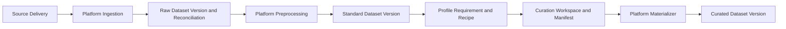

# Data Platform 页面功能与操作手册

> 源码同步：2026-10-26，合入截至 `acbb5a52` 的完整实现并保留已有操作指南。
> 实际安装身份与验收以发行记录为准；本次未重新验收远端 Agent 或逐项浏览器流程。

本文按“选择数据 → 查看与处理 → 复核与构建 → 检查任务结果”组织。页面按钮保留英文名称，便于对照操作。
本地默认地址为 `http://127.0.0.1:9091`；集中部署使用管理员提供的 HTTPS 地址。
MCAP 导入的 `Inspect only` 是格式预检；Explore 中的 `Data Inspect` 是已登记数据的只读行预览，两者用途不同。

常用章节：[进入与登录](#2-进入页面与账号权限)、[数据发现](#3-首页布局和通用操作)、[写入边界](#4-版本manifest-与写入边界)、[Viewer](#6-viewer浏览筛选和人工修订)、[Jobs](#11-jobs-抽屉与-pipeline-runs)、[推荐流程](#12-推荐操作流程)、[排障](#13-常见问题)。

## 1. 这套页面是做什么的

页面分成两个 Workspace：

- **Data Platform**：数据发现、接入、校验、缓存、预处理、不可变版本、血缘和物化执行；
- **Data Curation**：数据理解、语义质量复核、标注增强、Dataset Profile、Requirement、Recipe、cohort/去留决策和数据集构造；
- 两者共享顶部 Working dataset 选择器、Viewer、Jobs 抽屉和任务/审计记录。

| 你要做什么 | 页面入口 | 得到什么 |
|---|---|---|
| 找到并选择已有数据集 | `Data Platform > Datasets` | 当前工作数据集及节点、路径、缓存状态 |
| 把原始 MCAP 转为 LeRobot | `Data Platform > Data Import > MCAP → LeRobot` | 新的 LeRobot v3.0 数据集和逐文件报告 |
| 看任务、时长和标签分布 | `Data Curation > Explore > Overview > Open analysis` | 基础统计；不要求先生成 Cache |
| 看视频、曲线、逐帧复核 | `Explore > Overview > Open viewer` | 需已发布的 video/CSV 缓存 |
| 标准化、转换、拆分或合并 | `Data Platform > Preprocessing` | 新数据集，成功后注册输出 |
| 检测问题并人工复核 | `Data Curation > Quality > Quality Review` | flag/issue 证据和去留决策 |
| Stage、时序描述、框与标签 | `Data Curation > Annotation` | 可审核的标注结果 |
| 按需求筛选并发布训练数据 | `Data Curation > Dataset Build` | Recipe、Workspace、Manifest 及物化后的数据集 |
| 查看进度、日志、输出或失败 | 顶部 `Jobs`、`Data Platform > Pipeline Runs` | 任务状态、执行批次和结果入口 |
| 管理账号、节点和全局任务 | 顶部 `Platform management` | 按角色开放的管理页 |

默认工作流中，Curation 只保存草稿决策，不直接写 Parquet。Manifest 发布后，Platform 在 sibling 路径物化新的数据集版本。

推荐把它理解为下面这条流水线：



### 自定义算子链

**Data Platform > Preprocessing > Pipeline** 子视图可组合顺序步骤；顶部 **Pipelines** 快捷入口进入同一子视图，原 `/pipelines` 地址继续可用。

在 **AI assistant · Qwen** 描述需求，助手查询算子并预览；缺少必要前置步骤或明确的证据依赖时会补齐并重新校验。数据版本绑定由平台自动处理，默认流程图只展示业务步骤；手动编辑也会在校验时自动补齐。内部步骤仅在折叠的 **Technical details** 中供排查使用。
不能自动解决的问题按步骤显示；Blocked 草稿不能运行。AI added 标识本轮补入的前置步骤。
点击 **Load draft into editor** 应用草稿；已有编辑时先查看差异，可用 **Undo AI changes** 撤销本次应用。

流程图按顺序执行。点击节点在侧栏编辑参数，使用拖动、上下按钮或 Alt+方向键重排；
输入和证据生产步骤必须位于使用者之前，删除被引用节点需先处理引用。蓝色连线表示数据来源，虚线表示证据；
检测报告不替代源数据。模板、保存的流程和运行历史默认收起，高级参数和原有多数据源选项仍可使用。
点击 **Validate and run** 查看目标节点、输出和复核要求，再点击 **Confirm run** 保存版本并提交任务。
也可仅 Preview 或 Save version。AI 自身不提交任务、不批准复核、不修改源数据。

助手回复按段落、编号/项目列表、加粗和代码样式展示；算子 ID 用行内代码区分。回复中的 HTML 与任意链接不会执行，证据跳转和操作仍使用授权卡片。

右下角带对话图标的 **AI assistant** 是统一入口，页面顶部不再重复显示 Ask AI。
**Ctrl + Shift + Space**（Mac：**Cmd + Shift + Space**）唤出或收起；焦点在助手内时按 **Esc** 收起，
并返回先前的操作位置。普通空格、中文输入法候选操作、下拉框及平台弹窗的 Esc 保持原行为。
收起不会清空对话或未发送文字，也不会取消正在生成的回答或已经提交的任务。

Quality 的 **Explain report with AI**、Jobs 的 **Explain task with AI** 和 Pipeline 的
**Edit workflow with AI** 会明确携带当前对象打开同一助手。主界面仍可继续操作，
窄屏使用可收起的底部面板；独立 Pipeline 页和 Viewer 也支持入口及快捷键。
可解读字段、覆盖范围、质量候选和任务阶段，并通过证据链接回到页面；Viewer 账号只读问答。
输入框 **Enter** 发送、**Shift+Enter** 换行，中文输入法选字不会误发送。默认不再限制每小时对话次数；同一账号仍需等待当前请求完成。
如需执行，输入“帮我准备 Viewer”或“运行质量检测”，核对卡片的数据集、节点和参数后点击 **Confirm and run**。
操作卡片放在生成它的那条助手消息中，待确认的新操作展开显示；已有结果、运行中任务和旧请求显示为紧凑卡片，**Operation details** 可展开参数和详情。输入区不再固定显示旧卡片。已有结果提供 **Open prepared Viewer / Open Quality report / Open Review / Open derived dataset** 等入口；相同操作正在排队或执行时显示进度，不再提示重复提交。尚未执行时核对参数后点击 **Confirm and run**。
历史配置或产物无法核实时会明确提示；需要重新计算可先展开 **Operation details**，再展开 **Run again**（Viewer 为 **Rebuild Viewer**）并确认。Quality 必须同时查看实际检查项、episode 选择和媒体覆盖。缓存或报告可打开不代表已对当前源文件重新检测。报告入口直接定位卡片对应的结果，刷新保留定位；切换数据集或页面后清除旧定位。
**Change settings in chat** 将修改请求放入输入框，补充参数后重新生成卡片；**Refresh status** 刷新结果或任务状态。不默认自动执行。
卡片会显示任务状态，并提供 **Open run / Open Jobs**；重复确认不会创建重复任务。直接确认支持阶段计算、标注、打标、时序标注，以及拆分、格式/维度转换、删字段、平滑、标准化、数值编辑和轨迹/阶段对齐等单输入派生操作。需要额外证据、多数据源、模型路径或人工复核的复杂操作仍生成流程草稿或使用原专用表单。
新一轮对话会使未确认卡片过期，需要重新准备；已提交任务可刷新恢复。
助手的 **History** 可查看并恢复本人当前仍有访问权限的会话；数据或报告变化后会显示过期提示。默认勾选 **Follow current page**，切换页面、数据集或 Viewer Episode 时，侧栏标题与对话会跟随；每个上下文分别恢复历史。取消勾选可固定上下文，恢复历史会话也会固定；重新勾选即可回到当前页面。已提交任务不因切换而取消，旧操作始终保留原目标；过期卡片隐藏确认按钮。账号切换会清空旧账号的面板内容。

在 Viewer 问“当前 Instruction 是什么”时，助手读取当前 Episode 已发布元数据中的任务文本、长度和帧率，并提供当前 Episode 链接。无需存在名为 instruction 的数据列。侧栏显示当前 Episode；元数据未发布或不可安全读取时会说明限制。助手不会因此获得视频画面、原始信号行或页面上的任意内容。

**Preferences** 可设置回复语言、详细程度和最多五个常用算子，支持停用、修改和清空。设置与同账号、同环境的 CLI 共用，下次发送时生效。常用算子只影响建议，不会自动添加步骤或修改参数；助手不会根据聊天内容偷偷修改偏好。

**Memory** 保存你明确指定的术语、背景或沟通习惯；网页和 CLI 共用。可选择 **My account** 或 **Current dataset**，编辑、删除、清空或关闭 **Use saved memory**。最多 20 条，每条 500 字；每次提问只使用当前有权访问的最多 8 条，优先当前数据集。数据集身份变化或权限撤销后，不再读取该数据集记忆。聊天中的“记住”不会直接保存，需在 Memory 或 `/memory` 明确操作。停用和删除不改写已产生的聊天记录或已发送的模型请求，但会停止继续使用旧记忆的在途回答，需重新提问；记忆不能授权执行、修改阈值或跳过确认。

开启后台经验功能的环境中，助手可以引用本人已确认任务的历史共同结果。修改 Memory 后旧经验立即失效；新任务积累到足够证据后才会重新出现。经验不代表当前任务已经完成，也不会替你执行操作；没有可靠来源时仍使用普通助手流程。

**Updates** 查看本人已确认助手任务的完成、失败或取消总结。任务在后台跟进，关闭网页或 CLI 不会中断；当前会话有待跟进任务时网页自动刷新，重新打开后可查看。只有任务及对应 Attempt 已确认结束才生成总结，包含步骤完成情况和授权运行/结果入口；Quality 候选仍需人工复核。后续提问可引用当前会话最近三条授权总结。总结保留 30 天，不会自动提交后续任务、重试、审批或发送站外消息。仅跟进新确认的助手操作，不追溯升级前或其他表单的任务。Memory 中关闭 **Task completion updates** 会停止待跟进记录；重新开启后只跟进新确认，已生成总结在保留期内可再次查看。手动重试同一运行后旧总结隐藏，继续用 Jobs 查看重试状态。

也可使用[命令行助手](../clients/data-platform-cli/README.md)：复制其中的完整安装命令即可自动下载客户端和证书，并打开生产登录，无需手动下载文件或填写模型 API Key。需要 Python 3.10+、venv、curl 和公司网络/VPN。之后运行 `~/.local/bin/data-platform`，通过平台用户名、密码登录，使用 `/confirm` 确认新操作、`/status` 刷新状态、`/open` 查看授权结果链接；已有结果或失败记录需 `/confirm again` 明确重新运行。 CLI 0.3.4 对应 Server V0.3.5，启动时显示网页地址；`/web` 输出当前环境首页及已保存会话链接，`~/.local/bin/data-platform --web` 可免登录查看网址，`--version` 查看客户端版本。浏览器需独立登录同一账号。CLI 操作卡片直接显示完整结果网址；询问“网址在哪儿”或“链接打不开”会刷新授权链接，不生成任务。普通跟进不重复旧卡片，`/history` 保留其原消息。安装命令使用 `cli/latest/install.py`，重复执行即可升级；旧的固定版本地址仍安装原版本。CLI 0.3.2 起可退出后运行 `~/.local/bin/data-platform update` 升级；旧客户端只需再执行一次完整安装命令。输入 `/exit`、`exit`、`quit` 或在空输入行按 Ctrl+D 退出，Ctrl+C 只中断等待。
对话按账号、环境及目标隔离，可刷新恢复；输入版本、任务 Attempt 或报告变化后需 New chat。
请求发送用户文字、受限元数据及脱敏摘要，不自动上传原始行、图像视频、完整日志或文件路径。
请勿在提示词中输入凭据。未配置 Qwen 或服务暂不可用时，手动编辑仍可使用。
详见 [助手的数据范围与额度](data_platform_operators.md#qwen-draft-assistant)。

每次保存生成不可变 revision，运行固定该版本。多数据源必须来自同一节点。

Jobs 展示实际任务进度，Review 保存人工决策；Recent runs 可恢复等待复核的运行。
Split、Merge、Quality、Viewer 优先显示常用参数，其他参数在 Advanced parameters 中。
表单与 Parameter JSON 共用状态；Merge 可选择同节点且当前账户可读的数据集。
模板提供 Quality、Split → Quality、Viewer；后台保留必要的数据版本绑定步骤，仍需校验并确认后运行。
位姿插值需先在 Review 保存与流程参数完全一致的 pose repair 草稿，再从 Review draft 选择器选中草稿批准；提交会重新检查权限和 revision。
历史列表支持 Load more，展开的任务详情不会因新页到达而关闭。
Archived report 只在打开时读取 OSS；暂时不可用不会改变任务的完成状态。
源修改继续使用原有专用入口。接口、依赖限制和迁移清单见 [算子与流程](data_platform_operators.md)。

## 2. 进入页面与账号权限

### 2.1 集中部署：先登录，再选环境

已有集中服务时，直接打开管理员提供的 HTTPS 地址并登录。当前部署约定为生产 443、开发 8443；先检查页面顶部的环境、版本与身份，再执行操作。无需另外运行本地启动命令。

| 角色 | 常用能力 | 源数据修改 |
|---|---|---|
| `viewer` | 查看获授权的数据集、已生成 Viewer/Review 和 Analysis | 只读；不能提交计算或保存编辑 |
| `operator` | 提交支持的任务、保存允许的标注、管理自己的任务 | 远程 episode 删除需提交申请，由管理员审批 |
| `data_manager` | 常规任务与数据管理；受数据管理范围约束 | 仅能修改获授权的数据集，还需通过开关、能力和文件权限检查 |
| `admin` | 管理账号、数据授权、节点、审批和全局任务 | 仍受源保护、Server/Agent 开关和 Linux 权限约束 |

Viewer/operator 的 `Data permissions` 可限制读取及全部任务输入，Merge 的每个 source 也要获授权。
`selected-only` 空列表表示没有数据访问权；data_manager 的 scope 用于源数据写入授权。
按钮隐藏、禁用或显示能力不足时，先查看旁边的原因提示。详见[权限说明](data_platform_permissions.md)。

### 2.2 本地启动完整工作台

`--root` 应指向“包含一个或多个数据集文件夹的父目录”，不是必须指向某一个具体数据集。

```bash
cd /home/yuhao.song/Codes/data_platform
.venv/bin/python -m lerobot.data_platform \
  --root /path/to/datasets_root \
  --host 127.0.0.1 \
  --port 9091
```

启动后打开：

```text
http://127.0.0.1:9091
```

如果当前环境使用 `uv`，也可以把 `.venv/bin/python` 换成 `uv run python`。

### 2.3 远程机器上的临时本地服务

建议让服务仍然监听远端 `127.0.0.1`，在本地建立 SSH 隧道：

```bash
ssh -L 9091:127.0.0.1:9091 user@remote-host
```

然后在本地浏览器打开 `http://127.0.0.1:9091`。

### 2.4 `full` 和 `visualize` 两种模式

| 模式 | 启动参数 | 页面范围 | 写入行为 |
|---|---|---|---|
| 完整模式 | `--mode full`，默认 | 双 Workspace 的完整功能入口 | 取决于操作、账号和节点能力 |
| 精简模式 | `--mode visualize` | Cache、质量复核、Viewer、Analysis 等精简入口 | 仍可生成缓存；获授权时可执行保留的旧入口 |

`visualize` 表示功能精简；账号为 `viewer` 才表示只读权限。源数据原地写回由独立权限检查控制。
本地服务通过顶部 `Enter Admin` 设置或输入当前数据根的管理员密码，进入 Admin Mode；会话到主动退出、修改密码或浏览器会话结束时失效。集中部署直接使用登录账号权限，不另设一套本地管理员密码。

## 3. 首页布局和通用操作

页面上的数据集名称显示实际目录名，不显示 Agent 注册时添加的路径哈希后缀；内部标识和链接保持不变，同名数据集可通过节点和完整路径区分。

主页、管理页及独立工具页共用字体、焦点提示和导航样式。页面先显示操作和简短说明。权限限制、错误、费用及源数据修改风险仍直接显示。Temporal Caption 的 Annotation 和 Review 共用平台深色配色及 Dataset / Annotation / Review 导航；`Method & diagnostics` 按需展开，视频、片段和待人工审核提示保持可见。FLORA 方法会依次运行分段、Caption 和 Reward，关闭信号输入；Review 的 Reward review 分开展示整体结果与动作评分，点击 Window disagreements 区间或评分轨道可跳转，展开查看各窗口原始理由。评分分歧只表示待复核证据，不自动改动数据。

首页采用单主画布布局，不再常驻显示数据集左栏和任务右栏：

| 区域 | 用途 |
|---|---|
| 顶部第一行 | 切换 Data Platform/Data Curation、快速选择当前数据集、查看全局 Job 状态 |
| 顶部第二行 | 切换 Datasets、Preprocessing、Versions、Pipeline Runs 等功能页 |
| 主操作区 | 显示当前功能的配置、预览和执行结果 |
| 底部 Jobs 抽屉 | 按需查看最近任务、实时进度、日志和输出 |

当前源码中的交互补充（部署后生效）：

- 选中数据后，Datasets 页的 **Continue with** 提供 **Explore & Viewer**、**Quality review**、
  **Temporal Caption** 和 **Jobs for this dataset**。这些入口共享 working dataset。
- 当前会话在切换 Workspace 时保留上次页面和子页；刷新时仍按 URL 指定的页面打开。
- 未选择数据时可直接点击 **Select a dataset**，选择后继续当前功能。选择器支持搜索、
  Escape 关闭及键盘回焦；只读账号也可选择获授权的远程数据。
- **viewer ready / viewer missing** 指 Viewer 缓存状态，元数据加载完成不代表 Viewer 已准备好。
- Jobs 抽屉与 Pipeline Runs 共用数据集及状态筛选；**Active (including queued)** 包含排队任务。
  **Queued** 表示等待执行；提交成功和排队均不代表计算完成。没有匹配项时不会显示其他任务详情。
- Viewer、Analysis 和 Review 的 **Dataset console** 返回当前数据的工作台；键盘聚焦禁用的入口可查看原因。

整体设计与验收范围见[交互优化设计](data_platform_ux_design.md)。

### 3.1 第一次加载数据集

1. 打开 `Data Platform > Datasets`，在始终显示的 **Change server or scan a folder** 区域选择 Server，再从 **Known directory** 下拉菜单选择已有目录，或在 **Scan path / custom subdirectory** 输入路径。
2. 查找新目录时点击 `Scan`；查看已登记列表时点击 `Refresh`。
3. 页面用一个 `Datasets` 列表显示扫描结果，不再区分 `Available` 和 `Registered`。
4. 点击数据集即可将其设为 working dataset；如果它是首次出现，平台会在后台自动完成 Catalog 登记。页面自动补取轻量详情，具体操作在执行时按需加载数据，不需要单独执行 `Register` 或 `Load`。
5. 选中数据集后，通过顶部功能页导航进入所需操作；后续也可使用顶部 Working dataset 选择器快速切换。

目录下拉菜单随所选 Server 更新：Server A 显示当前管理根及已标记的源目录；Agent 显示其配置的
`allowed_roots`。选择目录后仍可编辑扫描路径，例如填写其中的子目录。选择 **Custom path…** 可清空
输入并填写自定义路径；Agent 自定义路径必须位于其 allowed 根目录内，不会新增授权根目录。

选择 Server A 本地目录时，`Scan` 扫描本机文件系统；选择 Agent 时，`Scan` 请求该节点立即扫描
输入路径并登记新数据集，不用等待默认的 300 秒自动扫描周期，也不占计算任务槽位。
任务运行或槽位已满时仍可扫描。页面显示等待、扫描中、完成数量或错误；只有 Agent 完成登记并
确认结果后才显示完成。列表中的 `Refresh` 仅重新读取已登记的数据集，不触发扫描。
切换 Agent 目录时，下方列表立即按目录筛选已登记数据，不需要再次 Scan。浏览器按当前账号及网页环境
记住最后浏览的 Agent 和路径，刷新后恢复；工作数据集与浏览目录分别保留。页面会显示当前列表路径，
搜索关键词仍会继续过滤。仅新增目录或需要立即发现磁盘变化时点击 Scan。
页面加载、返回首页和 Refresh 均读取已登记列表，不遍历 Server A 数据目录。显式点击 Scan 或本地
Rescan 才执行目录发现；`GET /api/dataset_roots?scan=0` 用于只读刷新，省略 scan 保留原有扫描语义。
数据集列表、任务列表及进度轮询只读取摘要，保留权限、操作能力、状态、进度和输出链接；
不反复下载逐 episode 元数据、执行快照和完整 MCAP 文件报告，减少远程访问时的列表超时。
完整执行证据仍保留在原记录与不带 `summary=1` 的 API 中。
即时扫描需要管理员、Data Manager 或具有全数据集读取范围的 Operator，并要求 Agent 在线且
支持即时扫描；Viewer 和受限 Operator 可用 `Refresh` 查看其权限范围内的已有数据集。
切换 Server/路径不会被旧扫描结果覆盖；离开页面不会取消 Agent 已接受的扫描。
扫描只读取源数据及元数据，不准备 Viewer，也不取消计算任务。Viewer 标注结果回传在任务运行时也继续执行；
同一数据集正在修改源数据或发布缓存时，该位置的回传稍后自动重试，其他位置继续同步。

扫描只识别存在 `meta/info.json` 的完整 LeRobot 数据集。cache-only 项目暂不出现在发现和选择界面。中央平台中，Viewer 账号只读；首次选择尚未进入 Catalog 的 Server A 数据集需要 Operator 或 Admin，Agent 数据集则由节点同步自动登记。

原始目录被删除后，在线节点会自动确认并移除对应数据集及其所属缓存。已有任务退出前保留工作缓存；
离线、不可读或共享缓存不会被当作可安全删除。历史任务与独立派生数据集继续保留，已删除的报告不可再打开。
重新放回同一路径后点击 Scan 重新登记并准备 Viewer。无需为了清理缓存执行源数据删除操作。

### 3.2 数据集列表和源数据保护

- `Datasets`：统一显示当前路径下发现的数据集；Catalog 状态由平台在后台维护，不需要用户切换列表。
- `Mark root as source`：将当前路径及其所有子目录视为源数据区，服务器拒绝原地删除、修复和覆盖。
- `protect`：只保护一个已注册数据集，适合它不在统一源数据路径下的情况。
- `unregister`：仅 Admin 可见，只移除 Catalog 记录，不会删除数据集文件，也不受源数据保护限制。

同名数据集应同时核对节点与完整路径。Server A 和 Agent 上相同的路径字符串可能指向不同文件。
cache-only 仍可作为已有缓存的访问上下文，但不作为新的源数据集被发现；它不能替代真实数据集参与源数据写回。

数据阶段与保护级别是两个独立维度：Raw、Standard、Curated 表示数据处于闭环的哪个阶段；`source protected` 表示是否允许原地修改。Preprocess 输出默认属于 Standard/Managed，只有输出仍位于受保护路径下或被手工标记时才继续受保护。

### 3.3 通用参数

Curation 表单默认显示常用参数；workers、模型覆盖、阈值和试跑选项收在 **Advanced settings**。
远端执行路径和权限说明可展开 **Execution location & access** 查看。Embedding、Compare
不显示无关的 Episode review，Data Report 只展示质量报告；选择草稿后才显示逐 Episode 复核字段。
结果选择器按当前操作筛选，切换结果后需重新打开，才能接受其中的标注或勾选 **Use for next run**。
切换功能页会清除计算输入勾选，未保存的复核字段仍保留；进度可随时在顶部 **Jobs** 查看。

| 参数 | 含义 | 建议 |
|---|---|---|
| `Robot / Stage profile` | 机器人语义、gripper 解释和 Stage 规则 | 优先读取 `meta/data_profile.json`；维度只用于旧数据兼容推断 |
| `episodes` | 指定 episode 子集 | 留空表示全部；试跑可填 `0,1,2` |
| `workers` | 并行 worker 数 | CPU/NFS 忙时调低，避免多个大任务同时跑 |
| `downsample` | CSV 曲线显示采样步长 | 只影响浏览曲线密度；例如 5 表示每 5 行取 1 行 |
| `output root` | 新数据集输出路径 | 优先写到源数据集旁边的独立目录 |
| `Dry run only` | 只计算计划和摘要，不真正写入 | 对转换、改名、拆分、合并、相减等操作建议先勾选 |
| `Overwrite` | 覆盖已有输出或缓存 | 确认输出目录和数据集无误后再启用 |

`workers` 是单个任务内的并行请求值；同时运行几个 Job 由节点槽位和用户配额控制，两者不同。
Agent 会结合 CPU/内存预算和 worker 上限收紧实际值，Job 的资源事件显示生效值及原因。
Episode 编号从 0 开始；`1,3-10,12` 的横线范围包含两端。Split 的 `0:50` 使用起止切片语法，具体以预览命中数量为准。

## 4. 版本、Manifest 与写入边界

### 4.1 需要版本化发布时的推荐路径

浏览、Analysis 或 Temporal Caption 不要求先走完整生命周期。需要可追溯地发布训练数据时，再使用以下步骤：

1. 在 `Data Platform > Versions & Lineage` 先登记 Source Delivery，再注册当前数据，生成不可变 `DatasetVersion`、完整 Content Manifest、Identity Artifact 和接入对账报告。
2. Raw → Standard 的组合处理先登记并执行版本化 Preprocessing Profile；workers 等运行参数不会改变 Profile 身份。
3. 在 Viewer、Quality Review、Annotation 中保存 sidecar 决策。
4. 为 Standard Version 生成 Dataset Profile，并发布目标数量、覆盖维度和质量约束组成的 Dataset Requirement。
5. 使用 cohort query、include/exclude、composition、exact dedup 和固定 seed 发布 Data Recipe；Recipe 会冻结为稳定 EpisodeRef 集合。
6. 将 Recipe 编译为可变 Curation Workspace；Workspace 使用 revision 乐观锁，也可导入已审核的 stage、prompt、bbox、tag 和 flag 证据。
7. 从 Workspace 执行校验，按 `draft → in_review → approved → published` 审核并冻结 Manifest。
8. 指定 sibling 输出路径并物化。Platform 按 `Planned → Running → Validating → Committed` 推进，结构、行数、时间戳和全部文件 SHA256 通过后才原子注册 Curated Dataset Version。

`episode_index` 只用于当前版本显示和输入；Workspace/Manifest 持久化为 `dataset_version_id + episode_uid`。UID 位于数据目录外的 Identity Artifact，复制数据时可一并导入；Split/Merge/Profile 通过显式 lineage 保持 UID。

### 4.2 写入范围

| 功能 | 写入位置 | 是否修改源数据集 | 风险等级 |
|---|---|---:|---|
| 注册、加载、从列表移除 | 工作台注册表 | 否 | 低 |
| Cache | `vis/local_vis_<dataset>/` | 否；可能覆盖缓存 | 低 |
| MCAP 导入 | 新 LeRobot 数据集、导入报告及检查点 | 否；已有目标拒绝覆盖 | 中 |
| Analysis、Embedding、Compare | 可视化/分析缓存 | 否 | 低 |
| Viewer 手工 flag、临时 tag | local_vis sidecar | 否，合并前只在缓存 | 低 |
| 普通 Stage/Prompt/Label/Tag 保存 | sidecar、相关缓存或 Curation Workspace | 否；本地旧管理员 Stage 完成保存可能触发写回 | 中 |
| Temporal Caption | 独立时序标注视频与结果 | 否 | 中 |
| Abnormal Flags 检测/清除 | flag 和 issue 缓存 | 通常否 | 中 |
| Manifest materialize | 临时目录，成功后发布为 sibling dataset | 否 | 中 |
| Standardize | 新的 sibling 数据集 | 否 | 中 |
| Convert action/state、Convert v3、Drop field、Smooth action | 新的 sibling 数据集 | 否 | 中 |
| Data Modification — Generate new dataset | 新的 sibling 数据集 | 否 | 中 |
| Repair、Rewrite、Delete、Viewer Trim Apply 等旧入口 | 获授权后写入源数据；普通账号不可直接执行 | 是 | 高 |
| Split、Merge、Subtract | 新的 sibling 数据集 | 否 | 中 |
| Object Labeling / Auto-tagging 运行 | local_vis 标注或标签结果 | 否 | 中 |
| `Merge to metadata` 旧入口 | 获授权后写入源 metadata | 是 | 高 |
| Data Construction | 新合成数据集 | 否 | 中 |
| Construction `Finalize rejected` 旧入口 | 获授权后修改目标数据集 | 是 | 高 |

本地旧入口要求管理员账号或已解锁的 Admin Mode，并保留源数据保护检查。远端入口还要求
Server/Agent 修改开关、数据集授权范围、允许读写根、节点能力和文件系统权限；仅打开 EDIT 不会取得源数据修改权。
具体以[权限说明](data_platform_permissions.md)及页面禁用原因提示为准。启用前建议：

1. 确认顶部 Dataset selector 中当前选中的数据集名称和路径；
2. 能 dry-run 的操作先 dry-run；
3. 打开顶部 Jobs 抽屉查看任务摘要和 `output`；
4. 对原地删除、裁剪、timestamp repair 和 metadata merge 先保留备份；
5. 等当前任务结束后再启动下一个写任务。

删除 Episode 或在 Viewer 原地裁剪帧时，页面会先显示影响数量，要求填写删除原因，并要求输入带数量的确认文本；删除原因、Episode 范围和任务结果会进入现有 Audit Log。`source protected` 数据集即使处于 Admin Mode 也会被服务器拒绝原地删除。

Datasets 页对远程数据源执行原地修改（包括 Delete by flag type 删除 Episodes）时，确认弹窗只需输入 `MUTATE`，无需附加数据集名称。删除原因仍为必填，原有权限检查和恢复备份继续生效。

## 5. 两个 Workspace 的主要功能

Quality、Stage、Labeling、Tagging、Embedding 和 Dataset Build 使用共享的 Curation 工作区。
提示缺少版本时，先点击 `Register dataset version`，在 Jobs 等待源数据身份与元数据扫描完成；这一步不改源文件。
生成结果后用 `Generated results > Open result` 查看，需传给下一项计算时勾选 `Use as computation input`。
人工决策保存在 `Review workspace` 的草稿中；它与自动结果分开。Temporal Caption 使用独立任务表单，不要求这一步版本登记。

### 5.1 MCAP → LeRobot：原始数据导入

用途：将 `genrobot_das` 适配器支持的 GenDAS MCAP 转为 LeRobot v3.0。其他 MCAP topic/schema 不能直接套用该适配器。

1. 打开 `Data Platform > Data Import > MCAP → LeRobot`，选择在线 Agent。
2. 搜索来源目录，分页勾选需要转换的目录；跨页选择保留。来源由 Agent 的允许读取根发现，无需已有 `meta/info.json`。
3. `Maximum files per folder` 默认 **3**，适合试跑；明确设为 **0** 才处理该目录全部文件。
4. 核对 `Output destination`。每个来源目录输出一个独立数据集，已有目标拒绝覆盖，原始 MCAP 保留。
5. 点击 `Convert selected`。任务自动检查信号、时间戳及有效连续片段；无需先执行 `Inspect only`。
6. 在 Jobs 查看逐文件检查/拒绝原因与 `Result summary`。完成后点击 `Use dataset`，需要视频浏览时再点 `Prepare viewer`。

| 设置 | 含义 |
|---|---|
| 默认输出 | 优先匹配 Agent 可写的同级 `<来源树名>_lerobot`，保留相对目录；其次使用允许范围内的来源同级 `<目录名>_lerobot` |
| `Custom output parent` | 自动输出不可用时填写该 Agent 可写根内的父路径；最终路径在提交前显示 |
| `Video short edge` | 默认 256 像素，保留比例并补齐偶数边长 |
| `Inspect only` | 可选的 MCAP 预检任务，报告进入 Jobs，不写 LeRobot 数据集 |

输出采用 30 FPS，包含左右腕部视频、末端 xyz/四元数与夹爪宽度；不生成 head、action、虚构 state 或任务阶段。
夹爪宽度保持米制，任务文本取来源目录的父目录名称。信号缺失或时间间隔过大会切开片段，一个 MCAP 可能生成多个 episode。
这些输出可用于 Viewer 和兼容的基础处理；用于策略训练前仍需定义所需 action 映射。

Agent 必须上报 MCAP 转换能力并完成运行环境自检。Admin/data_manager/operator 可提交，Viewer 只读；读取范围和输出根还受账号授权及 Linux 权限检查。
文件按资源预算并行处理，实际 worker 数在日志中显示，输出 episode 顺序保持来源文件排序。
安全 Retry 会校验并复用完成文件的检查点；成功发布后清理检查点，失败/取消时保留供重试。不要用新任务覆盖旧输出。

转换期间计算进程异常丢失且已确认退出时，同一 MCAP Job 可从校验过的检查点自动重新排队，
连续最多 3 次，历史 attempt 保留。主动取消、普通转换错误和发布失败不触发自动重算。
不要手动重复提交相同输出；在 Jobs 检查恢复记录，并以最终输出登记和可打开的数据集为成功依据。

### 5.2 Data Platform — Cache

用途：生成 Viewer 所需的视频和 CSV 缓存，不修改源数据集。

操作步骤：

1. 选择数据集，等待页面补取 metadata 并确认缓存参数可用。
2. 打开 `Data Platform > Preprocessing > Cache`。
3. 确认 Robot / Stage profile、episode 范围、downsample 和 workers。
4. 勾选 `Prepare videos`、`Prepare CSV`。
5. 第一次运行不要勾选覆盖；需要重建时再选：
   - `Recompute all cache`：重建视频和 CSV；
   - `Recompute CSV only`：只重建 CSV，保留视频。
6. 点击 `Prepare cache`。
7. 在顶部 Jobs 入口确认任务完成，再到 `Data Curation > Explore` 打开 Viewer。

默认缓存目录是数据集相邻的：

```text
<dataset_parent>/vis/local_vis_<dataset_name>/
```

v3.0 数据集使用只读适配器生成 Viewer cache，准备 cache 的过程不会修改 v3 源数据。

远程数据集的 `Prepare viewer` 在数据所在 Agent 执行，先发布到注册的 `output_dir`，再上传至 Server A 的
`remote-cache/<location_id>/static/`。计算完成后可能仍处于发布、上传或确认阶段；以 Job 终态及 Viewer 实际可打开为准。
重新生成缓存时保留已有人工标注与数据集身份检查，不应手工清空整棵缓存目录。

### 5.3 Data Curation — Stage & Subtask

用途：自动计算或人工修订 Stage/Subtask，生成阶段曲线和文本标签。

正常使用时选择 episode、Stage 规则和重算选项，生成 sidecar 后在 Viewer 复核。
以下写回/修复选项属于本地旧管理员流程，能否显示和执行取决于当前入口与权限：

| 选项 | 作用 |
|---|---|
| `fallback stage count` | 对不匹配 pick/place/give 规则的任务按时间等分，默认 5 段 |
| `Repair episode indices` | 修复 `frame_index`、`timestamp`、`index` |
| `Force stage recompute` | 忽略已有阶段，重新计算 |
| `Write stage to parquet` | 把 `subtask_state` 写回 Parquet |
| `Write subtask text` | 根据 stage 写入 subtask 文本 |
| `Overwrite subtask text` | 覆盖已有 subtask 文本列 |
| `Overwrite parquet labels` | 强制重算并写入 stage/subtask，同时重建 CSV |

默认推荐用法：

1. 首次只选择少量 episodes，点击 `Compute stages`，生成并检查 sidecar 结果。
2. 运行后在 Viewer 检查 Stage 曲线和边界。
3. 确认规则正确后，在 Cohorts & Dataset Build 导入 sidecar 并发布 Manifest。

旧的红色 `Dataset mutations` 仅在 Legacy Admin 模式显示；它们会修改源数据。

### 5.4 Data Curation — Quality Review

用途：按数据实际字段运行检查，查看测量证据与覆盖范围，再保存人工决定。末端位姿检测属于同一 Quality 体系。

| 检查类型 | 适用信号 | 能发现什么与限制 |
| --- | --- | --- |
| Control signal consistency (`control`) | 兼容布局的关节 Action/State 与夹爪 | 过早夹爪切换、状态与指令不一致、短暂归零；结果需复核 |
| Task & stage annotations (`annotations`) | task_index、声明的 subtask_state 等标注 | 多任务文本、文本格式提示、阶段缺失/无效/恒定；不声明阶段则跳过阶段检查，单阶段恒定可能正常 |
| Joint motion (`s1`) | 弧度语义兼容的 DVT 关节信号 | 跳变、速度异常、无效时间戳；夹爪不套关节阈值，UMI 位姿不适用 |
| End-effector motion (`eef`) | 命名的 XYZ + 四元数位姿，如 UMI/GenRobot | 无效位姿、四元数范数、时间间隔和位置/姿态突跳候选；单位未知不推断为米 |
| Numeric validity (`s3`) | 数值标量/向量 | 缺失、NaN/Inf、维度错误；越界与非法编码需明确配置且单位匹配 |
| Image & video quality (`c3`) | 源图像/视频 | 缺失、解码错误、黑帧及模糊/冻结候选；默认抽样不能证明未检查帧通过 |

操作步骤：

1. 在 **Run quality checks** 选择适用检查与 episode；不可用项显示缺少的信号或画像要求。
2. workers、重算和阈值位于 **Advanced settings**。兼容 DVT 默认使用 DVT2；旧规则可明确选择 DVT1。
3. 提交后在 Jobs 查看进度，完成后在 **Inspect results** 选择结果；**Data Report** 展示最新保存报告，
   可切换历史结果。数据集总量、实际检查数量、问题数量和视频覆盖分别列出，零 flag 不等于全部通过。
4. 点击 issue 的 episode 展开 **Review episodes**，用 **Open in Viewer** 查看候选区间；没有缓存先准备。
   页面保留草稿。打开 Viewer 不自动保存决定；人工选择 Keep、Exclude、Needs review 或修复建议后保存。

EEF 的基线取本次所选 episode，改变选择可能改变候选；模糊、冻结、运动突跳和格式提示都不能直接判定任务失败。
只读账号可查看已有报告和 Viewer，不能运行检查或保存决定。检测、报告与复核本身不修改源数据，
通过 Dataset Build 物化已审核决定。Data Report 位于集中部署 full 控制台；独立/精简模式沿用原入口。

旧流程的一键修复和删除需对应源数据修改权限；清除 flag 只影响复核结果：

| 按钮 | 作用 | 是否改源数据 |
|---|---|---:|
| `Normalize prompts to lowercase` | prompt 转小写，并处理重复 task/task_index | 是 |
| `Trim first frame for early gripper transition` | 删除命中 episode 的第一帧并重建相关数据 | 是 |
| `Set stuck closed gripper action to closed` | 修复 gripper Action | 是 |
| `Add action lead for state-only gripper transition` | 为 State-only 变化补 Action 提前量 | 是 |
| `Delete all flagged episodes` | 删除所有当前 flagged episodes | **是，不可逆** |
| `Clear all flags` | 清除 flag/issue 结果 | 通常不改 Parquet，但会清除复核状态 |

不要把“被 flag”直接等同于“应该删除”。建议先在 Viewer 按原因筛选，把去留或修复决定写入 Manifest；Platform 物化时才生成新版本。

### 5.5 Data Platform — Standardize

用途：生成统一的 16D Action/State Standard sibling 数据集，源数据集不修改。

这里的 DVT2 表示机器人和 Stage 规则，不表示输出向量维度。Standardize 后机器人仍是 H10W
DVT2，信号 schema 变为 `dual_arm_standard_16d`；两者分别记录，不再把 16D 输出命名为 DVT1。

标准化流程会：

- 缺 cache 时先准备 cache；
- 按 DVT2 规则归一化 gripper 第 7/15 维；
- 把 Action/State 截到 16D；
- 删除 depth 字段；
- 写入 Stage/Subtask；
- 修复 episode/frame 索引。

操作步骤：

1. 打开 `Data Platform > Preprocessing > Standardize`。
2. 确认 source robot profile（当前默认 H10W DVT2）和 workers；只有真实旧机器人数据才选 DVT1 legacy。
3. 如需仅从输出中排除部分 episode，在 `delete episodes` 填 `1,3-10,12`。
4. 第一次建议勾选 `Dry run only`。
5. 在 Jobs 抽屉确认 dry-run 摘要后取消 dry-run，再运行 `Standardize dataset`。
6. 默认输出为稳定路径 `<src>_preprocessed`；已有目录时必须明确勾选覆盖。
7. 完成后输出数据集会注册到页面，再对它准备 cache 并复核。

输出的 `meta/data_profile.json` 会固定 `robot_profile`、`signal_schema`、`gripper_encoding` 和
`stage_profile`。复制、重启、Split/Merge 或再次计算 Stage 时均优先使用该画像，不再依赖
Action/State 的长度猜 DVT1/DVT2。

### 5.6 Data Platform — Transform

`Transform` 用于生成 schema/feature 变化后的 sibling 数据集。v3 timestamp repair 属于原地修改，需管理员或获授权的远端数据管理员，并通过对应入口的安全检查。

| 操作 | 用途 | 关键参数 | 输出行为 |
|---|---|---|---|
| `Convert action/state dim` | 调整 Action/State 维度 | `target dim` | 新 sibling 数据集 |
| `Convert dataset to v3.0` | v2.1 转 LeRobot v3.0 | data/video shard 大小、workers、视频编码模式 | 默认 `<src>_v3` |
| `Repair v3 video timestamps` | 把 MP4 显示时间戳重排到 FPS 网格，并更新 episode 时间范围 | dry-run | **原地修改 v3 MP4/meta** |
| `Drop field` | 删除指定字段 | 完整字段名 | 新 sibling 数据集 |
| `Smooth action` | 对 Action 做居中滑动平均；可同时处理 State | 奇数 window、workers | 新 sibling 数据集和 Smoothing report |

v3 视频编码模式：

- `LeRobot official`：AV1 / YUV420 / CRF 30，体积小但有损；
- `RGB lossless`：H.264 RGB / CRF 0，像素无损但体积更大。

`Smooth action` 的 window 必须为奇数。它会平滑所选字段的所有维度；这不是只平滑机械臂、保留 gripper 的专项 trajectory cleanup。

平滑完成后，Transform 页面顶部和对应 Job 详情会出现 `Smoothing report`，可逐 episode、field、dimension 查看 before/after 曲线、RMS delta 和最大绝对变化。

### 5.7 Data Modification：批量修改信号值

用途：将选中 episode 的某些 Action/State 维度统一设为指定值，同时重算相关 episode/global stats。
入口位于 `Admin > Admin Operations > Data Modification`，按账号与节点能力开放。

1. 选择 field、joint/dimension 和 `set value`；`Add joint` 可添加多条修改。
2. 选择 `Selected episodes` 并填写编号，或明确选择 `All episodes`。每条编辑会应用到所选 episode 的全部帧。
3. 优先选择 `Generate new dataset`，核对新的输出路径；先 dry-run 查看命中范围。
4. 正式执行后使用新输出，重新准备 Viewer 验证曲线。未选中的维度和 episode 应保留。

`Modify source in-place` 会直接修改当前数据集，要求源数据写入权限；受保护源禁止选择。
远程原地修改还要求填写原因和确认，Agent 保留恢复备份。保存 Viewer 的 Trim 标记不会执行数值修改。

### 5.8 Legacy Admin — In-place Dataset Ops

本节仅用于兼容旧管理员流程；未取得对应权限时入口隐藏或禁用，后端拒绝写入。
正常流程请把 prompt、删除和 repair 决定写入 Manifest。

| 操作 | 用途 | 数据写入 |
|---|---|---|
| `Rewrite prompts` | 使用正则表达式批量替换 task 文本 | 原地修改 metadata；实际运行前自动备份到 `meta/prompt_rewrite_backups/` |
| `Fix prepositions` | 统一绝对位置 `on the left/right` 和相对位置 `to the left/right of` | 原地修改 metadata；有 metadata 备份 |
| `Apply pending prompts` | 应用 Viewer/Label Review 中暂存的 prompt 修复 | 修改 episode metadata 和对应 Parquet `task_index` |
| `Delete episodes` | 按 ID 或 flag 类型删除 episode 并重排索引 | **原地删除** |

`Delete episodes` 支持：

- 手工输入：`1,3-10,12`；
- 选择某种 flag 类型，自动填入全部命中的 episode ID。

删除按照当前数据集删除前的 episode ID 解释，并从高 ID 到低 ID 执行。成功后无法撤销；失败时会尝试恢复删除前快照，但不应把它当作正式备份机制。

### 5.9 Data Platform — Materialize（Split / Merge / Subtract）

三种操作都生成新数据集，不改源数据集；成功后会自动注册输出。

#### Split

用途：按 episode 范围或 task 筛选，从当前数据集提取子集。

- `episode range` 示例：`0:50`；
- `task filter` 可填 task 文本或 `task_index`，多个值用逗号分隔；
- 先 dry-run，再确认输出路径和命中数量。

#### Merge

用途：合并至少两个已注册数据集。

1. 选择两个或更多 source。
2. 可为每个 source 单独填写要排除的 episode。
3. 填输出文件夹名；输出基目录是当前 `root_dir`。
4. 设置 workers，先 dry-run。
5. 正式执行后，Parquet、视频、cache、label、tag、flag 等索引会随新 episode 编号重映射。

`Signal dimensions` 默认选择 `Strict`，要求同名字段维度一致，已声明的信号维度名称和顺序也必须一致。
选择 `Minimum` 可以合并不同维度的 `action`、`state`、`observation.state`：

- 每个字段独立采用维度最小的 source 的名称和顺序；维度相同时采用先选中的 source。
- 根据 `meta/info.json` 中完整且不重复的 `features.<field>.names` 匹配和重排，支持名称列表或单轴字典。
- 最小 source 的所有维度必须存在于每个 source 中。缺失维度、未命名、重名、单位或语义不兼容都会拒绝，不会按位置截断或猜测名称。
- 机器人、FPS、夹爪编码和 stage profile 仍须兼容。17D flag 与 19D 身体关节不能因为索引相同就当作同一维。
- Dry run 的 job 摘要包含 `dimension_alignment`：目标名称、每个来源对应的索引（从 0 开始）及被丢弃的名称。
- 只写新数据集，同步更新实际向量、schema 和 episode/global stats。页面和 CLI 会从输出重建 CSV，再完成注册；其他视频、标签和人工标注沿用原有索引重映射。

CLI 参数：`--preprocess-merge-dimension-policy min`；API 参数：`options.dimension_policy: "min"`。
直接调用 Python `run_merge(..., dimension_policy="min")` 时，旧 CSV 不会复制；如需 Viewer 缓存，需对输出执行 cache preparation。

Agent 数据集也支持 Merge：选择远端 working dataset 后，source 列表仅显示同一 Agent 上可用的数据集。
选择至少两个 source，再选择 `Minimum`；输出可留空自动生成同级目录，也可填写该 Agent writable roots 下的绝对路径。
Agent 会执行同样的维度检查、统计更新和 CSV 重建，上传输出的 Viewer 缓存，然后在控制台注册新数据集。
Dry run 仅返回计划，不生成输出或上传缓存。跨 Agent 合并不支持。

服务器和 Agent 都需更新到包含此功能的版本，并重启服务；页面根据 Agent 心跳上报的 `preprocess.merge` 能力显示远端 Merge 入口。
远端 API 使用 `POST /api/control/locations/{首个source的location_id}/preprocess-jobs`，请求示例：

```json
{
  "op": "merge",
  "options": {
    "source_location_ids": ["source-a-location-id", "source-b-location-id"],
    "dimension_policy": "min",
    "exclude_episodes": [[], [1, 3]],
    "workers": 8,
    "dry_run": true
  }
}
```

`source_location_ids` 包含全部 source，顺序决定同维度时采用哪一个布局；`exclude_episodes` 与它逐项对应。
控制端从注册记录解析源路径，Agent 再次校验同节点、允许读取范围，以及输出与每个 source 分离。

#### Subtract

用途：从当前数据集 A 中，排除在一个或多个数据集 B 中出现的相同 episode，输出 `A - B`。

- 当前选中数据集固定为 base A；
- 选择一个或多个 subtract source B；
- 按稳定内容指纹匹配，不依赖可变的 `episode_index`、全局 `index` 或 `task_index`；
- 只生成新数据集，不会从 A 中原地删除；
- 如果会删除 A 的全部 episode，操作会拒绝输出空数据集。

## 6. Viewer：浏览、筛选和人工修订

Viewer 在 cache 准备完成后可打开。页面主要包含视频、时间轴、Action/State/Gripper/Stage 曲线和 episode 列表。

### 6.1 浏览与筛选

- 按 episode 编号跳转；
- 按 Instruction（task 文本）筛选；远程缓存 Viewer 也会自动加载该列表；
- 只看 flagged episodes，或继续按 flag 原因筛选；
- 按一个或多个 tag 名称和值组合筛选；
- 点击曲线维度复选框控制显示；
- 多视角视频共用播放状态和时间轴，操作任一视频的播放、暂停或进度条会同步其他视角；放大视频也参与同步；
- 在任一 Charts 绘图区单击或直接拖动，可暂停并同步定位所有视频、其他图表、时间条和数值表；两张图保留所选帧的蓝色竖直定位线，悬停或播放不会移动该线，再次点击或拖动选帧才更新；悬停仅预览信号，不跳转视频；
- 选帧后，在 Charts 区域向上滚轮放大、向下滚轮缩小，围绕固定帧聚焦；未选帧时保留普通滚动。`Reset zoom` 恢复完整范围并保留定位线，切换 Episode 后清除定位线。`Ctrl + 拖动` 仍可缩放图表，`Shift + 拖动` 平移，两张图表的范围联动；打开、收起或调整助手侧栏宽度时，图表会同步调整尺寸。Trim 和 Stage 边界拖动仍按原有编辑权限执行；
- 点击视频放大；
- 播放速度支持 `0.25x`、`0.5x`、`1x`、`2x`、`3x`、`5x`。

Instruction 下拉框以及勾选 `Flagged` 后的 flag 类型下拉框会显示加载或空列表状态。
加载失败时页面会显示错误和 `Retry Instructions` / `Retry flags`，可重试读取；不会因此清除已有 flag。
缺少具体原因的 flagged episode 可按 `Unknown flag reason` 筛选。筛选无需等待结果回传 Agent 完成。

常用快捷键：

| 按键 | 功能 |
|---|---|
| `Space` | 播放/暂停 |
| `←` / `→` | 降低/提高播放速度；编辑 trim handle 时用于微调 |
| `↓` / `↑` | 下一个/上一个 episode |
| `F` | 打开 flag 原因窗口 |
| `A` / `D` | 暂停播放并后退 / 前进一帧；长按连续移动，松开停止 |
| `N` | 推进一个 Stage/Subtask |
| `T` | 开关 Trim 模式 |
| `B` | 编辑 background tag |

### 6.2 Flag 和 prompt 修复

- 点击 `OK/FLAGGED` 或按 `F`，选择人工问题类型并保存；
- 可移除已有人工 flag；
- 遇到多 task 或 prompt 问题时，页面会要求选择/输入正确 prompt；
- Viewer 保存的 prompt 先进入 `prompt_assignments_pending.json`，保存本身不改源 task。推荐将已审核决定导入 Workspace 后物化；旧管理员流程使用 `In-place Dataset Ops > Apply pending prompts`，获授权后才写入源 metadata 和 Parquet。

### 6.3 Stage 编辑

1. 点击 `EDIT OFF` 切换为 `EDIT ON`。
2. 播放到 Stage 边界处，点击 `S:x/y` 或按 `N` 依次推进 Stage。
3. 可在曲线上拖动阶段边界；按 `A/D` 逐帧定位，按 `N` 推进 Stage。
4. 点击 `Save stage`。

保存行为要特别注意：

- cache-only / Agent Viewer 保存阶段标注及相关缓存，不会直接合并到远端源 Parquet；
- 本地源数据 Viewer 的旧管理员流程可以在阶段完成时触发合并，但还受管理员权限和源数据保护检查约束，不能把这一行为套用于普通账号或远端缓存编辑；
- 网页保存与 Agent 同步是两步。只有显示 `Results synced` 才表示对应结果已在 Agent 确认落盘，仍不代表应用到源数据。待同步或错误状态参见[运维排障](data_platform_operations.md)。

### 6.4 Trim 和 Delete

- 保存 Trim 起止标记仅修改缓存标注；有源数据修改权限时，`Apply` 使用**当前显示的起止帧（两端包含）**执行裁剪，保留区间内帧并重写相关数据和视频。
- 远端 `Apply` 提交 `mutation.trim_episode` 任务，需要确认和原因，并通过 Server、Agent、数据范围及文件权限检查。任务提交成功后仍需在 Jobs / Runs 确认完成，再重新准备 Viewer。
- `DEL` 删除 episode 并更新相关数据、metadata 和索引；不要求先打开 EDIT。远端管理员或获授权的数据管理员可直接提交，operator 走删除申请与管理员审批，viewer 只读。
- Apply 和实际删除属于源数据原地修改，不可依赖浏览器撤销；缓存标注保存、审批通过和任务完成是不同状态。`unregister` 只移除登记，不删除数据集文件。

Viewer/operator 的可见数据集还受 Data permissions 限制；selected-only 空列表表示无数据访问权。
数据管理员的 scope 用于源数据写入授权。详细规则见[权限说明](data_platform_permissions.md)。

### 6.5 保存、同步和应用的区别

| 页面状态或动作 | 已经发生什么 | 下一步 |
|---|---|---|
| `Save` 成功 | 标注或 sidecar 已保存在当前服务端缓存 | 远程结果继续检查同步状态 |
| pending / syncing / error | 尚未获得 Agent 对该结果 revision 的落盘确认 | 查看错误、等待 Agent 空闲或按提示重试同步 |
| `Results synced` | Agent 已确认对应 revision 的结果 | 仍只是结果文件，未自动修改源 Parquet |
| Apply/删除申请已提交 | 后端接受请求或创建任务 | 去 Jobs / Runs 检查执行结果 |
| 删除申请 approved | 管理员批准，创建删除执行任务 | 等待 Agent 执行成功并复核数据 |
| Manifest 物化完成 | 校验后发布并注册新数据集版本 | 使用输出，核对 Viewer 与 Analysis |

Agent 需要上报 `result_sync_protocol=1` 才支持网页结果回传。不要用覆盖缓存来处理 pending/error；具体恢复见[运维排障](data_platform_operations.md)。

## 7. Explore 可视化中心与 Analysis

进入 `Data Curation > Explore > Overview`，按当前模式和本地/远程上下文查看可用的 Data Inspect、Viewer、Analysis、Label Review、Tag Review、Construction Review、Embedding、Compare 和 Smoothing Report 入口。Temporal Caption 使用 Annotation 中的独立 Review 链接。

- `Ready`：产物存在，可直接打开；
- `Needs cache` / `Not generated`：产物尚未生成，按钮会跳到对应的 Cache、Annotation、Dataset Build、Embedding、Compare 或 Transform 配置页；
- 卡片只负责展示状态和引导准备流程，不会在点击时自动启动后台任务；
- `visualize` 模式显示该模式允许访问的 Data Inspect、Viewer 与 Analysis，避免暴露被服务端禁用的功能。

### Data Inspect：只读记录预览

选择数据集后，在 `Explore > Overview > Inspect` 点击 **Open data inspect**。
本地 LeRobot v2.1/v3.0 默认查看原始 Parquet；远端 Agent 数据集只查看已发布的 Viewer CSV。
打开 Inspect 不要求准备视频，也不会生成 CSV、启动任务或修改源数据及缓存。

- 选择 episode、从 0 开始的行偏移和每页数量，默认 50 行，最多 200 行；用 Previous/Next 翻页。
- Fields 默认勾选全部字段；切换数据源或 episode 后也会重新全选。可搜索并取消不需要的字段，再点 Load rows。
  字段信息来自实际文件 schema 和声明的 feature metadata。
- 点击记录展开所有字段的 JSON；CSV 重复表头按列位置区分，数组保持实际结构。
- 图片和二进制只展示字段信息，不加载媒体内容。大数组/字符串明确标记截断，单次响应不超过 2 MiB。
- Parquet 展示存储值，不做信号归一化。v3.0 共用 shard 时只返回当前 episode 的记录。
- CSV 展示缓存文件中的实际文本，可能已降采样或包含派生字段，与现有 Viewer 曲线接口的展示值存在差异。
  来源栏显示文件相对路径、采样步长和源 episode 帧数；缓存行数只在读到文件结尾时可得，不额外全量计数。
  普通 `.csv` 和压缩 `.csv.gz` 缓存均可直接预览，无需手动解压或重新生成缓存。
- 缺少 CSV 时可切回本地 Parquet，或通过 Open Cache 进入现有准备流程；Viewer 账户仍保持只读。
- 远端通过 location_id 读取该位置的已发布缓存，Agent 离线时仍可查看。页面显示同步时间与缓存状态；
  过期缓存不代表当前源数据。首版不读取远端 Parquet，也不支持 MCAP、数据编辑或全量下载。

只读 API：`GET /api/datasets/{namespace}/{name}/inspect/schema`、`.../rows`；
远端使用 `GET /api/control/locations/{location_id}/inspect/schema`、`.../rows`。
参数为 `source=parquet|csv`、`episode_index`、`offset`、`limit`；`columns` 可重复指定 schema 返回的列 ID。
所有接口遵守现有数据集范围权限，不能指定任意文件路径。

### 7.1 Analysis：直接查看基础统计

1. 选择本地或 Agent 数据集，在 Explore 点击 `Open analysis`。
2. 需要更新统计时点击 `Refresh analysis`，不会自动启动 Prepare cache。
3. 按任务类型、属性、instruction、时长或已有标签筛选。
4. 已有 Viewer 产物时，从 episode 行进入视频复核。

任务分布、episode/frame 数量与时长来自 metadata；时长按 `length / fps` 计算，v3.0 也可从 episode 的索引区间读取帧数。
CSV 降采样行数不作为完整数据帧数。已有 CSV 可补充 Stage/对象存在统计，已有 tag 可用于 cohort 筛选。
可选 CSV 显示 `Not generated` 只表示未生成，不会因此产生异常 flag；无法读取的 CSV 则保留诊断。

远程 Analysis 读取 Agent 最近同步的元数据并显示同步时间，已有报告在 Agent 离线时仍可查看。
报告缺少 episode 长度时不会补造时长，应等待元数据同步后刷新；自动同步默认在启动时及每 300 秒发生。
任务分类使用已应用的 Task catalog；旧 Stage 与当前策略不兼容时，不纳入该部分统计。
Analysis 可能保存源目录外的小型派生统计，但不生成 video/CSV，也不修改源数据。

## 8. Data Curation：标注功能

### 8.1 Temporal Caption：任务与审核

用途：为一个 episode 生成可审核的时序语义描述。它与 Stage 分段、首帧目标框标注各自独立。

| 方案 | 主要用途 |
|---|---|
| `FLORA` | 使用节点配置的离线模型进行时序分段、描述与奖励评估 |
| `Multi-view Semantics` | 多视角视觉语义与边界细化 |
| `Video + Events` | 结合视频与可选事件证据生成时序描述 |
| `Fusion + Review` | 融合证据并给出模型审核意见，供人工复核 |

1. 进入 `Data Curation > Annotation > Temporal Caption`，选择方案。
2. 选择 episode 编号/范围或整个数据集；第一次先试一个 episode。
3. 决定是否勾选 `Include action/state, pose and gripper signals`，检查执行能力提示后提交。
4. 每个 episode 创建独立任务，进度统一在 Jobs 查看；只选择“全部”不会调用模型。
5. 打开 Review，分别选择 episode、方案及保存的 run/result，查看同步视频、分段时间轴、描述与审核意见。

离开页面会停止本批次继续提交，已经接受的任务仍会执行。批次中断后按页面恢复提示继续提交，已确认任务保持幂等。

表单的 Review 链接进入视频与结果审核页；episode 选择与方案/运行结果选择分开。
这条流程不需要先创建 curation snapshot，也不需要先准备 Viewer。只读账号不能提交推理任务。
关闭信号输入后，模型只使用视觉证据；任务需要支持该选项的 Agent。
FLORA 不使用 action/state、pose 或 gripper 信号；该方案禁用信号选项，并独立检查节点离线运行环境。

模型审核结果仍是待人工核实的证据，不能当作人工批准或源数据修改。caption 区间为左闭右开，
与 Viewer Trim 的双端包含约定不同。Fusion V2 的信号变化和时间对齐也不等于接触或任务成功。
方法、版本、限制和产物详见[时序标注说明](temporal_caption_trial.md)。

### 8.2 Task setup 与共享 Qwen 配置

任务类型、对象、属性和别名可通过 `Task setup` 维护，旧 Pick/Place/Give 与新增任务使用版本化定义。
加载 instruction 并选择 catalog 后，可用 `Suggest with AI` 生成建议，人工选择并执行
`Save selected & preview > Apply to dataset`。建议只使用任务文本与 catalog，无需 Cache；不明确的 instruction 保留人工配置。
应用映射仍会触发已有的后台 CSV 刷新流程。详见[任务配置指南](data_platform_task_catalog.md#ai-assisted-task-setup)。

Qwen API Auto labeling、VLM Auto-tagging 和任务建议共用服务端 `DASHSCOPE_API_KEY`；已有配置时每任务的 API key 可留空。
Qwen Gradio 使用独立 ModelScope token。配置由管理员在目标环境的 Server 配置中维护，重启对应服务后生效；
双环境的文件位置见[运维手册](data_platform_operations.md)，配置项见 [README](../README.md#shared-qwen-api-key-on-server-a)。

### 8.3 Object Labeling

用途：从 episode 的第 0 帧识别 task 目标对象和参考对象，生成候选 bbox 及置信度。

后端：

| 后端 | 特点 | 数据是否离机 |
|---|---|---:|
| `Local GroundingDINO` | 本地模型，可指定 CUDA devices 和阈值 | 否 |
| `Qwen Gradio` | 调用配置的 ModelScope/Gradio API | **是，第 0 帧会上传** |
| `OpenAI-compatible VLM` | DashScope 或本地 vLLM/SGLang 兼容接口 | 取决于 endpoint；外部服务会上传第 0 帧 |

操作步骤：

1. 选择 backend，确认依赖和 token 状态。
2. 可先启用 `Trial sample`，按 task 类型抽样少量 episode。
3. `run mode=Only missing` 会保留已有结果；`Full rerun` 会替换选中范围的结果。
4. `Save vis PNG` 保存检测可视化图。
5. 点击 `Run object labeling`。
6. 完成后打开 `Generated results` 或对应 Job 结果；已有 Viewer 缓存时再进入 `Label review`。

### 8.4 Label Review

Review 页面可：

- 按 prompt、置信等级和 reviewed/unreviewed 筛选；
- 播放 episode 视频并查看第 0 帧 bbox；
- 比较多个 labeling backend/variant 的叠加框；
- 选择、删除、拖动、缩放或手画 target/reference bbox；
- 修复 prompt、添加 flag、编辑 background tag；
- 保存人工复核结果。

快捷键：

| 按键 | 功能 |
|---|---|
| `j` / `k` | 下一条/上一条 |
| `Enter` | 保存当前标注 |
| `Backspace` | 清除当前选择 |
| `r` | 恢复原始自动结果 |
| `f` | 设置 flag 原因 |
| `b` | 编辑 background tag |

复核保存到 sidecar。推荐将已审核 bbox/prompt/flag 导入 Workspace，通过 Manifest 物化新数据集。
`Merge to metadata` 属于旧源数据写回入口，只有获得相应权限并确认目标后才执行；保存 Review 不等于已 merge。

### 8.5 Auto-tagging

用途：为 episode 生成结构化标签。

当前标签 schema：

| 标签 | 含义 | 后端 |
|---|---|---|
| `background` | round_table、square_table、tv_cabinet、sofa | VLM |
| `background_color` | 背景主要颜色 | VLM |
| `object_count` | 可见任务相关物体数 | VLM |
| `prompt_action_match` | match、mismatch、unclear | VLM |
| `arm` | left、right、both、unclear | 规则 |
| `grasp_xy` | 抓取点二维坐标 | 几何计算 |

操作步骤：

1. 选择需要生成的 tag；只选 rule/geometric tag 时不需要 VLM。
2. 如包含 VLM tag，配置 endpoint、token、model。
3. 先用 `Trial sample` 小范围验证。
4. 点击 `Run auto-tagging`。
5. 打开 `Tag review`，逐条检查和修改。
6. 确认后保存 sidecar，导入 Workspace；确需源数据写回时再使用获授权的 `Merge tags to metadata`。

当 `prompt_action_match=mismatch` 时，结果会同步成为异常 flag，便于在 Viewer/Analysis 中复核。

### 8.6 Tag Review

Tag Review 页面可：

- 点击 tag chip 构造一个或多个组合筛选；
- 搜索当前筛选结果；
- 查看第 0 帧、episode XY 轨迹和抓取点热力图；
- 修改各 tag 值并 `Save`；
- `Reset` 回退当前人工修改；
- 获授权的 `Merge to metadata` 把当前标签写入 v2.1 JSONL 或 v3 Parquet metadata。

远端页面编辑的是已发布缓存；可保存结果时仍需检查同步状态，不能据此推断源 metadata 已修改。
cache-only 上下文可使用已有 Review 结果，写回必须具有真实源数据上下文及对应权限。

## 9. Data Curation：Data Construction

用途：基于已有 Object Labeling 结果，把源 episode 重新组合/重标 task，构造新的负样本或合成数据集。

前置条件：已有 Object Labeling 结果；在共享工作区选择对应结果作为计算输入，并确认生成场景与标签兼容。

支持场景：

- `single_pick`；
- `directional_pick`；
- `relative_pick`；
- `give`。

参数：

| 参数 | 作用 |
|---|---|
| `uncertainty threshold` | 控制可用于构造的标注置信/不确定度范围 |
| `Oversample factor` | 增加候选数量，留出人工 reject 空间 |
| `Include positive examples` | 输出中同时保留源正样本 |
| `Allow pick-to-give examples` | 允许普通 pick 样本转作 give 来源 |
| `Examples per scenario` | 每类场景需要的目标数量 |

推荐流程：

1. 点击 `Preview construction` 检查 vocabulary、候选数和场景分布。
2. 为需要的场景填写目标数量，核对输入结果和 oversample 等参数。
3. 点击 `Generate data`，生成新的 sibling 数据集，实际输出路径在 Job 详情中查看。
4. 从 Data Construction 页面顶部或对应 Job 详情打开 Construction review。
5. 按场景、缺失对象和决策状态筛选；对每条记录 Accept 或 Reject。
6. 在输出数据集的 Review workspace 保存去留决定，通过 Publish & build 生成审核后的新数据集。

Construction review 快捷键：`j/k` 上下条、`a` 接受、`r` 拒绝。旧管理员入口的 `Finalize rejected`（快捷键 `f`）会物理删除合成输出中的 rejected episode，需源修改权限；无法依赖浏览器撤销。

### 9.1 Cohorts & Dataset Build：筛选、审核并发布

用途：将可重复的筛选规则和人工决定冻结成 Manifest，再生成独立的 Curated 数据集。

1. 在 `Data Curation > Dataset Build > Cohorts & Dataset Build` 确认已登记版本。
2. 需要统计画像时点击 `Create dataset profile`。填写 task、include/exclude、目标数量、随机 seed 和 exact dedup；可用 metadata filter 与分组数量/权重控制配比。
3. 点击 `Create & compile recipe`，创建固定 EpisodeRef 集合和 review draft。也可用 `New draft` 从当前版本开始。
4. 选择 Review workspace；通过 `Import existing review` 导入已有 sidecar，或逐 episode 保存 `Keep/Exclude/Needs review/Repair`、原因、task、Stage、tag、bbox 和修复建议。
5. 点击 `Validate & publish draft`。平台在执行节点复核源数据，成功后发布不可变 Manifest；输入有变化或存在冲突时按提示处理。
6. 选择 `Published manifest`，确认输出路径和 workers，点击 `Build curated dataset`。
7. 在 Jobs 确认验证、发布和注册都完成；使用新输出并复核 Viewer/Analysis。

已发布 Manifest 不可修改，继续修订需新草稿。保存 Exclude/Repair 只是决策；物化时才应用到新的输出。
自动质量 flag、模型审核与人工审核状态分别保留，不能把一次模型判断直接当成删除依据。

## 10. Data Curation：Embedding 和 Compare

### 10.1 Embedding

用途：使用 OpenPI/策略 checkpoint 为每个 episode 生成向量，再投影成二维散点图。

首页参数：

- checkpoint 路径；
- OpenPI config；留空时从 checkpoint 目录的 `train_config_full.json` 读取；
- layer hook，默认 `pi_prefix`；
- episode 子集；
- workers 和 CUDA devices；
- `Refit reducer`：重训降维器，已有点的二维坐标可能移动。

Embedding 页面可：

- 按 task 或任意 tag 着色；
- 使用 UMAP/PCA、cosine/euclidean/manhattan 等投影选项；
- 调整 neighbors、min_dist 和 seed 后重新投影已有 embedding；
- 悬停查看第 0 帧，点击点查看 episode、task、tag、坐标和 Viewer 链接。

workers 通常对应独立 OpenPI 进程；多 GPU 时再提高，先确认单个 worker 的显存占用。

### 10.2 Compare

用途：比较两个已注册数据集 A/B。

操作步骤：

1. 当前选中数据集作为 A。
2. 在 `Dataset B` 下拉框选择 B。
3. 点击 `Build compare cache`。
4. 任务完成后从 Compare 页面顶部或对应 Job 详情打开 Compare result。

Compare 当前生成：

- metadata：episode、frame、FPS、task、camera、Action shape；
- Action：最多前 64 个 episode 的各维 mean/std/min/max；
- vocabulary 交集和各自独有对象；
- single/directional/relative pick 与 give 场景分布；
- tag 分布；
- A/B 可视化样本；
- 两边已有 Embedding 时的点数和可用状态。

Compare 页面目前偏审计视图，统计和 overlap 主要以 JSON 展示。

## 11. Jobs 抽屉与 Pipeline Runs

### 11.1 顶部 Job 状态与底部抽屉

顶部 `Jobs` 按钮显示运行数量、最近进度或失败状态；点击后从底部展开抽屉，包含：

- 状态、进度百分比、当前步骤；
- current/total；
- elapsed 和 ETA；
- 输出路径；
- 实时日志和错误堆栈摘要。

Agent 支持独立任务并行，最多 8 个槽位；实际并发取 Server 上限、Agent 上报能力和用户配额的限制。
源/输出路径冲突的任务排队，同一数据集不同 episode 的 Caption 可并行；源数据原地修改独占节点。
Server A 本地执行器仍为单槽。排队时查看 `queue_wait_reason` 和 `node_slots`，不要反复提交相同任务。

关闭抽屉不会停止任务或轮询。Pipeline Runs 的 `Refresh` 同时读取本机和远端任务列表。
数据集页和 Platform management 中，节点、数据集和任务在各自请求完成后立即更新；任务请求较慢
不会阻塞已返回的数据集列表，失败时保留该列表上次成功读取的内容并显示错误。

进度使用任务独立快照；普通日志、刷新或切换页面不会将已知百分比清零。同一次执行的总体进度
不倒退，重试则从新的一次执行开始。`current/total` 是当前阶段的已完成数量，不一定等于总体百分比。
Viewer 的计算和上传使用不同进度区间；上传数量在传输成功后增加，只有任务完成确认后才显示 100%。
旧任务回调没有总体阶段权重时，百分比采用历史最高估计值，可能暂时停留；请结合当前阶段判断。

默认日志保留阶段变化、每约 10% 的里程碑、普通重要提示与全部警告/错误，逐条计数不再刷屏。
Pipeline Runs 的 `Detailed events` 可查看远端任务最近保留的详细事件；完整诊断仍沿用原有事件/审计流。
摘要日志采样不会降低任务进度快照的更新频率，也不会删除数据集或操作审计记录。

任务完成后，先确认状态为 `done/success`，再打开新输出或开始下一个写任务。

如果任务生成了新的数据集，输出卡片会提供 `Use dataset`。Viewer cache 尚未生成时还会显示
`Prepare viewer`；点击后直接在输出所在的 Server A 或 Agent 上启动 cache 任务。cache 完成后，
同一输出卡片会改为 `Open viewer`。

### 11.2 结果与产物入口

`Data Curation > Explore > Overview` 会始终显示当前模式允许访问的可视化卡片，并根据产物状态提供 `Open` 或准备入口；对应功能页顶部和 Job 详情中仍保留就近的结果链接：

- Viewer；
- Analysis；
- Label review；
- Construction；
- Tag review；
- Embedding；
- Smoothing report；
- Compare。

按钮显示 `missing` 或禁用时，应先完成对应前置任务，而不是直接拼 URL。

Agent 数据集也可以进入 `Data Curation > Explore > Overview`。远程 Explore 展示 Dataset Analysis 和
Episode Viewer。Analysis 直接使用已同步的元数据；Viewer 有 cache 时直接打开，没有 cache 时
有任务权限的账号可启动 `Prepare viewer`。Embedding、框标注、构造等结果不通过远程 Explore 卡片开放；
支持的任务与结果使用各自 Curation 功能页，Temporal Caption 从 Annotation 的 Review 进入。

### 11.3 Pipeline Runs 与 Operation history

`Data Platform > Pipeline Runs` 提供最近任务、输出和日志，可按全局/当前数据集及任务状态筛选。Operation history 是统一的操作审计记录，可按 status 和 operation 筛选。列表仅加载摘要，展开单条记录时再读取完整详情；加载失败可重试，刷新失败保留上次成功列表。展开可查看：

- 操作时间和 actor；
- 数据集和 operation；
- 参数、episode IDs、输出目录；
- accepted/started/success/failed 状态；
- 结果或失败原因。

它适合回答“谁在什么时候对哪个数据集做了什么”，但不能替代数据备份。

## 12. 推荐操作流程

### 12.1 只浏览和分析

```text
Datasets 选择节点/路径 → Scan 或 Refresh → 选择数据集 → Open analysis
                                              → Prepare viewer → Viewer（需要视频时）
```

整个流程不需要修改源数据；只读用户查看已有 Viewer，缺缓存时请有任务权限的用户准备。

### 12.2 生成 Standard 数据集

```text
Cache → Viewer 初检 → Quality Review → 人工复核
→ Standardize dry-run → Standardize 正式运行
→ 注册输出 → Cache → Viewer + Analysis 复核
```

优先用 Standardize 输出 sibling 数据集，不要先在原始数据上批量删除。

### 12.3 标注并构造合成数据

```text
Register dataset version → Object Labeling trial → Object Labeling full
→ Label Review / Episode review → 选择已审核结果为计算输入
→ Data Construction Preview → Construction
→ 输出的 Review workspace 保存去留 → Publish & build
→ 使用审核后的新输出 → Viewer + Analysis
```

### 12.4 自动标签和数据集对比

```text
Auto-tagging trial → Auto-tagging full → Tag Review
→ 保存 sidecar / Workspace → Analysis tag cohort
→ 选择 A/B → Build compare cache → Compare
```

### 12.5 导入原始 MCAP

```text
Data Import 选择 Agent/来源目录 → 最多 3 个文件试跑 → 核对输出 → Convert selected
→ Jobs 检查报告与输出 → Use dataset → Prepare viewer → Viewer + Analysis
→ 确认适配与资源后，将每目录文件数设为 0 处理全部
```

### 12.6 时序标注或版本化发布

```text
时序标注：选择数据集 → Temporal Caption 选择方案/信号 → 单 episode 试跑
        → Jobs 确认完成 → Review → 确认方法后提交所需范围

版本化发布：登记版本 → Profile / Requirement / Recipe → Review workspace
          → 保存去留与修复建议 → Validate & publish draft → Build curated dataset
          → Jobs 确认输出发布 → Viewer + Analysis 验收
```

## 13. 常见问题

### Viewer 按钮是灰色

- 确认当前节点、数据集和账号有读取权限，等待轻量详情加载完成。
- video/CSV cache 缺失时，由有任务权限的账号点击 `Prepare viewer`，或回 Cache 同时准备 videos 和 CSV。
- 远端已完成计算但未发布/上传的缓存仍不可用；先检查对应 Job 的阶段与错误。

### Analysis 没有 episode 行

- 检查本机 episode 元数据是否可读，或远程 Agent 是否已上报 episode 清单。
- 远程缺少清单时，升级 Agent 并等待自动元数据同步（启动时及默认每 300 秒）；然后点击 **Refresh analysis**。
- 不需要通过 Prepare cache 补齐基础分析。

### Labeling 或 VLM tag 无法启动

- backend 依赖不可用；
- endpoint 填成了网页地址而不是 API 地址；
- token 未设置；
- 外部 API 无法访问；
- 先用 Trial sample 验证单个 task 类型。

### 任务很慢或机器负载过高

- 降低 workers；
- 限定少量 episodes 试跑；
- NFS 上避免同时重建视频、CSV 和多个大数据集；
- Embedding 每个 worker 都可能启动一个 OpenPI 进程，先从 1 开始。

### 输出已存在

- 先确认它是不是之前需要保留的产物；
- 优先换一个 output root；
- 只有明确要替换时才启用 overwrite。

### 页面提示 `source protected`

- Review、Flag、Annotation 和生成 sibling dataset 的操作仍可使用；
- 删除 episode、原地 value edit、prompt 修复、时间戳修复等写回操作会被服务器拒绝；
- 若这是手工保护，可在 Datasets 页面取消；若来自路径规则，应将派生输出写到源数据区之外，或取消该 root 的保护策略。

### Remote Scan 禁用，或 Refresh 看不到新目录

- `Refresh` 只读 Catalog；查找新目录要用 `Scan`，也可等待 Agent 自动扫描。
- 检查 Agent 在线状态和 `dataset_scan_protocol=1`，只有 Server 更新到新版不够。
- 受限 Operator/Viewer 没有新路径发现权限，由管理员登记并授权。
- 扫描路径、软链接真实目标和服务账号权限都要在允许读取范围内；扫描失败后按错误修正。

### 已保存标注，但 Agent 或源数据没有变化

- 网页 Save、`Results synced`、Apply/Manifest 物化分别表示缓存保存、Agent 落盘、数据变更。
- 结果 pending 时检查 Agent 是否空闲、是否支持 `result_sync_protocol=1`；error 时查看具体同步错误。
- `Results synced` 不会自动把 Stage/prompt/tag 合并到源 Parquet/meta。按需要使用 Workspace 物化或获授权的旧写回入口。

### Job 排队、长时间同一进度，或停止后仍显示运行

- 排队先查看用户/节点配额和路径冲突提示；增大 workers 不会增加 Job 槽位。
- 相同进度可能在处理单个大文件或发布/upload；核对当前阶段、事件时间和输出活动再判断停滞。
- `Request stop` 只表示已接受请求；等待执行器确认退出后才显示 `cancelled`。
- `interrupted` 要核实执行状态，不能立即重复计算。已完成计算但上传失败时，应使用受支持的安全 Retry 保留结果。
- 网络超时导致提交状态不确定时，先在 Jobs/Runs 查 Job，再按原页面的重试提示操作。

### MCAP 没有来源、无法转换，或只转换了少量文件

- 检查来源是否已配置到目标 Agent 的允许根、转换运行环境是否就绪，以及账号范围。
- 默认每目录最多 3 个文件；设为 0 才处理全部。
- `Convert selected` 自动预检，拒绝原因在 Jobs 的 Result summary；不必额外提交 Inspect 来修复错误。
- 一个文件可能分成多个有效 episode，缺失 head/action 属于当前适配器输出约定。
- 输出已存在时换新路径，或按原任务支持的安全 Retry 恢复；不能覆盖已发布数据集。

## 14. 机器人画像与 Stage 策略

### 14.1 UMI 数据与处理能力

数据列表不再显示 DVT1/DVT2 分类标签，而显示实际机器人类型与 LeRobot 存储版本。
UMI 数据可直接准备三路预览缓存、查看头部/左右手位姿与夹爪曲线、运行基础分析和同结构拆分合并。
曲线的单位和坐标系未声明时保持未知，夹爪显示采集值；依赖 DVT action/state 的操作不可用。
原始信号统计代表完整数据集，不随筛选变化。详细操作和写入行为见 [UMI 数据支持](umi_dataset_support.md)。

### 14.2 默认 Stage 策略

处理表单默认选择 `H10W DVT2 · stage v1`（`h10w_dvt2_stage_v1`），切换到旧 DVT1 数据也不会
自动改回旧规则；需要兼容旧行为时手动选择 DVT1。数据集列表的机器人类型与处理默认值分别显示。

Quality 和夹爪问题修复同样默认使用 DVT2；Quality 无需再确认推断出的 DVT 档案，
可直接勾选 S1。需要旧规则时，在 Quality 的 Advanced settings 中选择 DVT1。
S1 仍要求兼容弧度的关节信号；UMI 不使用这套关节检测。默认值不会改写原数据的来源档案。

UMI 的 Cache 和 Stage 表单显示 `时间等分 · 5 段（UMI）`；可调整“时间等分段数”（至少 2）。
UMI 的所有任务按 episode 的起止时间均匀切分，不使用关节位姿、夹爪阈值或 DVT 标准化。
已有合法 Stage 默认保留，主动重新切分会重新生成缓存阶段。本地和远程 Agent 接收同一段数与重算选项。

## 15. 平台管理与任务控制

管理员使用现有账号登录 `/control-plane` 后直接看到使用日志和只读数据库面板。
任务行按实际权限显示重试、排队取消、请求停止、强制终止和优先级选项；没有额外管理员入口。
“请求停止”成功只代表请求已接受，直到执行器确认进程退出后才显示 `cancelled`。
`interrupted` 表示节点执行状态尚需核实，不会立即重新执行。
本地请求重放、原地修改及旧 Agent 的运行中控制可能不可用，页面会显示能力限制。
日志库未配置或暂时离线会显示提示，不会把未知日志结果当成成功。
详细配置和部署步骤见 [多用户管理与任务执行](data_platform_multi_user_management.md)。

### 15.1 平台管理入口

集中部署时，首页顶部的 **Platform management** 打开平台管理页，替代原先 Nodes 入口和账号菜单中的
Manage users。复用现有登录与权限，不需要第二套管理员账号。

- **Overview**：查看近期任务中的运行、排队、异常数量及在线节点，点击卡片进入对应列表。
- **Jobs**：按状态、操作、数据集、Job ID 或“我的任务”筛选；每页 20 条。Details 展示执行批次、
  错误和近期事件，原始记录折叠显示；重试、取消、终止仍由后端能力与权限决定。
- **Nodes & datasets**：查看节点及其数据位置，保留 Viewer 准备和数据控制台跳转。
- 管理员另外可见 **Users & access**、**Usage & audit** 和 **Database**，分别管理账号权限、查询使用日志、
  只读浏览数据库。日志和数据库在切换到对应页签时加载。

概览及任务筛选基于当前接口加载的近期任务，不代表平台历史总量。页签可通过 URL 中的
`#jobs`、`#users` 等直接打开；小屏幕下页签和宽表格可横向滚动。

节点、数据集和任务列表分别加载；任务请求失败不会隐藏已加载的节点或数据集。
失败时保留上次列表并显示对应错误，成功刷新后清除错误。Operator 可以查看已登记节点，任务列表仍只显示自己的提交。

### 15.2 自己的任务与管理员任务控制

Jobs 抽屉和 Pipeline Runs 页面共用任务控制：operator/admin 可重试自己已结束且支持重试的任务，
取消自己的排队任务，或请求停止支持安全停止的运行任务。按钮旁显示 username 和不可操作原因。
请求停止只表示已接受停止意图，须等待执行器确认所有进程退出；不会立即显示取消完成。
Viewer 角色保持只读。

这些页面使用 `/api/jobs/<id>/retry` 和 `/api/jobs/<id>/cancel`，后端强制校验提交者。
管理员操作其他人的任务应进入 Platform management → Jobs，沿用管理员控制接口。
管理员可在排队任务上点击 **Use extra quota (+1)**，让这个任务使用独立于提交者普通并发额度的一个名额。
例如普通上限为 2、已有两个任务运行时，给选中的第三个任务启用额外 quota 后，Agent 可在有空闲槽位时领取它。
每次授权只属于所选任务；不会改变账号的永久额度，也不会把名额分给其他排队任务。
页面显示 **Extra quota enabled**；任务仍排队时可点 **Revoke extra quota** 撤回。
机器/Agent 总并发、数据路径锁、维护状态和数据访问权限仍有效，授权成功不代表任务已经开始。
额外任务不占用普通名额；结束后不再占用并发槽位。手动 Retry 会清除授权，同一 MCAP 任务的自动恢复保留授权。
普通 operator、data_manager 和 viewer 均不能启用或撤回额外 quota；授权和撤回记录在现有审计日志中。
未适配安全恢复的任务、旧协议执行或退出待确认的任务仍可能禁用重试/停止，不因管理员身份跳过执行安全检查。
管理页面的常规用户展示统一使用 username；API 的稳定 user_id 继续用于关联和权限判断。

### 15.3 开发环境与角色体验

开发入口使用服务器 HTTPS 的 8443 端口，生产入口保留 443。页面顶部显示环境、版本和当前身份。
开发管理员登录后，可在顶部切换到操作员 A、操作员 B 或只读用户，并返回管理员。切换是真实权限体验：
API 校验、任务归属和配额使用当前测试用户，已提交任务不会因为随后切换而改变归属。
同一浏览器的开发标签页同步切换，生产会话独立。普通账号与生产环境没有角色切换入口。
测试用户需由管理员先运行 `data-platform-environment seed-dev-users --env dev` 初始化。
维护期间新任务和其他业务写入暂不可用；具体部署和验收见 [双环境部署指南](data_platform_environments.md)。

### 外部助手

可用自己的 Codex / Claude Code 和模型 API 连接 [MCP](data_platform_mcp.md)。
外部助手准备操作后会返回平台确认链接；登录同一账号、核对数据和参数，再点击 **Confirm and run**。
打开链接或模型调用本身不会执行任务。凭证创建、查询和撤销使用独立 CLI。

## 16. 版本依据与延伸文档

本分支已合入 `acbb5a5298910cca95f65e0876de19eeec91100a` 的完整平台实现，
并保留原有文档整理。源码同步不等于重新部署或完成在线验收；实际安装身份及验收以发行记录为准。

- [运维与结果同步排障](data_platform_operations.md)
- [开发与生产存储位置](data_platform_storage_locations.md)
- [权限、数据范围与删除审批](data_platform_permissions.md)
- [任务定义、别名与 AI 建议](data_platform_task_catalog.md)
- [时序标注方法、审核与限制](temporal_caption_trial.md)
- [多用户管理与任务执行](data_platform_multi_user_management.md)
- [生命周期与物化契约](data_lifecycle_architecture.md)
- [UMI 数据支持](umi_dataset_support.md)
