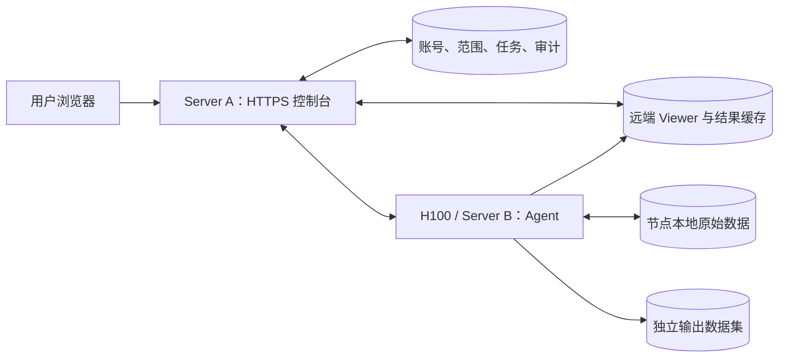

# 多服务器统一数据平台当前情况说明

> 更新日期：2026-10-15。本文汇总近期已实现能力、操作边界与核对依据。
> 安装身份与源码核对不等于线上验收；动态状态请按[运维手册](data_platform_operations.md)重新检查。

## 1. 核对范围

安装身份快照：2026-10-15 18:04（Asia/Shanghai）。

| 对象 | 本次观察 | 结论边界 |
| --- | --- | --- |
| 主工作区 | `/home/yuhao.song/Codes/data_platform`，`agile-robots`，HEAD `dacf352c` | 主目录落后于近期功能，不可直接当作最新发布源码 |
| 功能源码 | `git log --all`、各 worktree 及下面列出的提交 | 证明提交存在；上线包含关系须核对安装文件或发行包 |
| dev Server | `current` 与 `release.env` 为 `V0.0.6.55_DatasetIndexRefresh_20261015` | 仅确认本机安装身份 |
| prod Server | `current` 与 `release.env` 为 `V0.0.6.55_DatasetIndexRefresh_20261015` | 仅确认本机安装身份 |
| Agent、服务和用户流程 | 本次未重新检查远端心跳、维护状态、TLS 或完整浏览器交互 | 不宣称全量线上验收通过 |

运行时文件核对：`.54` 的目录浏览、Inspect、Quality、Agent、配额、压缩和滚动升级等 9 个文件
与 `4547c15f` 一致；`.55` 的 `viewer.py` 与 `5380474d` 一致。

安装目录内也可能保留较早日期的文档，不能仅因文件位于 `current` 就认定其中地址或运行状态是实时值。
本次仅修改文档与本地代理规则，没有合并功能分支、构建发行包、部署、重启服务或修改数据集。

## 2. 架构与数据边界

平台采用 **统一管理、分散存储、就地计算**：

Server A 同时承载独立 dev/prod 服务、数据库与状态；Agent 的环境、数据根及输出根由各自配置登记。
工作区源码、不可变发行包、安装后的 `current`、执行暂存、发布缓存是不同对象。详情见
[存储位置](data_platform_storage_locations.md)。平台不合并各服务器磁盘，也不把原始数据集中复制到 Server A。

支持 LeRobot v2.1/v3.0、UMI 和已适配 GenDAS MCAP。源数据默认保护；预处理、转换和物化生成
独立输出。Viewer 账号只读；operator/viewer 的数据范围限制读取与任务输入，data_manager 的写范围
与 Linux 权限、Agent roots、源修改开关共同生效。缓存标注回传不等于源 Parquet 写回。

## 3. Data Infra：近期能力与操作

| 内容 | 当前实现与使用边界 | 提交依据 |
| --- | --- | --- |
| 数据目录浏览 | 选择授权根或自定义子路径；切换目录立即筛选已登记数据；按账号/环境恢复浏览位置，与 working dataset 分开 | `930cf6a3`、`4547c15f` |
| 被动刷新 | `.55` 页面加载、返回首页与 Refresh 只读登记；显式 Scan/Rescan 才发现本地目录 | `5380474d` |
| 列表响应 | Nginx 压缩 JSON；批量读取 Job 关联记录；节点、数据集和任务分别渲染，失败保留上次成功内容 | `1f44fd2d`、`f3165e76` |
| 任务额度 | 管理员可给单个排队任务额外用户额度；不突破节点槽位、路径锁、维护或权限 | `57146fd5` |
| 任务恢复 | MCAP 计算进程丢失后从校验检查点自动重新排队，连续最多 3 次；取消、普通错误、发布失败不适用 | `fcf8d674` |
| 滚动升级 | 兼容时保留旧执行服务收尾，新版接管后续任务；不兼容则等待，生产仍需验收批准 | `e4d5f7dd` |
| 执行器稳定性 | 本地执行器复用 Agent，关闭旧 Caption 读取连接与线程，避免轮询累积句柄 | `fac8d01d` |
| 控制面存储 | 减少无变化同步和例行心跳的重复写入；保留实际变化、失败与任务审计 | `9870717b` |
| Server B 接入 | 管理/部署密钥与隧道密钥分开，稳定局域网名和隧道自动重连；跨子网不保证 mDNS | `2effd65b`、`f4348d47` 及历史操作记录 |

远程执行最多支持 4 个槽位，实际并发取 Server、Agent、用户额度和路径锁共同限制；这不是每台节点
当前都开了 4 槽的声明。扫描无需等待计算槽，后台结果同步也不占计算槽；同位置冲突仍需等待。
任务停止要等执行器确认进程退出，重新排队和收到停止请求都不能算任务完成。

2026-10-14 的列表超时修复曾通过 Nginx 热加载恢复页面，未重启计算服务；当时响应约缩小 88%。
这是历史记录，不是当前性能基准。持久化代码与现场配置分别验证，参见运维手册的列表排障流程。

## 4. Data Intelligence：近期能力与操作

| 内容 | 当前实现与使用边界 | 提交依据 |
| --- | --- | --- |
| Data Inspect | 本地 Parquet、远端已发布 CSV 的有界只读预览，兼容 `.csv.gz`，默认全选字段；缓存不等于实时源数据 | `17346fdf`、`4508c50f` |
| Quality 检查 | 控制一致性、任务/阶段标注、关节运动、末端运动、数值有效性、图像/视频六类，按实际信号启用 | `8e3fd455`、`4608f388` |
| Quality 报告与复核 | Data Report 展示数据总量、已检查范围、问题及媒体覆盖；连接 Episode Viewer 并保留复核草稿 | `86ac1590` |
| DVT2 默认处理 | 兼容 DVT 表单与关节检查默认 DVT2；UMI 保留位姿与时间分段路径，不套用关节阈值 | `add8e481`、`104044e6` |

质量判断按“问题类型 × 可用信号”组织。EEF 是整体 Quality 的一部分；关节与末端数据也能共享数值、
标注和媒体检查。末端突跳、模糊、冻结和文本格式提示是人工复核候选，零 flag 不证明未检查数据合格。
先运行检查、查看报告及覆盖，再在 Viewer 复核并保存 Keep/Exclude/Needs review 或修复建议。
检测不能直接驱动源数据删除。具体步骤见[页面手册](data_platform_page_user_guide.md#54-data-curation--quality-review)。

现有时序标注继续使用共享任务表单和独立 Review，支持批量 episode、可选信号与数据集本地实验结果读取。
模型审核和人工批准分别记录；关闭信号时不提供 Action/State 证据。已接收任务不会因离开页面而取消。
版本化 Curation 保留草稿 revision、Manifest 审批顺序与 episode lineage，最终物化为新数据集。

## 5. 日常操作顺序

1. **找数据**：核对环境与角色，选择 Server/授权目录；Refresh 看登记，Scan 发现磁盘变化。
2. **理解数据**：Analysis 看元数据，Inspect 看实际记录或缓存，Viewer 看视频和信号；留意同步时间。
3. **处理与复核**：先选小范围运行，检查 Jobs 终态和已发布输出；质量候选在 Viewer 人工复核。
4. **写入与同步**：明确是缓存 sidecar、Curation 草稿还是源数据写回；同步需匹配 revision 的 Agent 确认。
5. **发布**：核对 worktree、全部功能提交与安装基线，在干净集成工作区完成测试后构建，dev 验收批准后
   将同一不可变包用于 prod；已有包重试使用 `--release`，不复用 `--version` 重建。
6. **验收**：Server/Agent 安装身份、有效心跳与能力、维护关闭、正常 TLS、受影响账号流程分别核对。

## 6. 仍需保留的限制

- 存储仍分散；数据副本注册与 lineage 不等于自动跨节点同步原始数据。
- 远端 Viewer 和 Inspect 依赖已发布缓存；过期缓存不能证明当前源数据状态。
- 高可用控制面和对象存储不能从当前架构或历史计划推断已完成。
- 滚动升级仍有短暂维护；`quiescent: false` 的备份不能用于完整自动恢复。
- MCAP 自动恢复只覆盖明确的进程丢失条件；恢复单个任务不证明其他故障都可自动处理。
- 稳定 `.local` 名称与事件驱动地址通知有网络范围限制；开机配置不等于实际重启通知已验收。
- 本次未重新执行功能测试和线上验收；文档证据以已核对代码及本机安装身份为限。

## 7. 延伸文档

- [页面操作手册](data_platform_page_user_guide.md)：用户入口、参数与结果。
- [运维手册](data_platform_operations.md)：发布、滚动升级、SSH、TLS、列表与任务排障。
- [存储位置](data_platform_storage_locations.md)：源码、发行包、数据库与缓存。
- [权限](data_platform_permissions.md)与[多用户任务管理](data_platform_multi_user_management.md)：范围、角色和控制。
- [时序标注](temporal_caption_trial.md)与[生命周期](data_lifecycle_architecture.md)：审核、结果和版本化构建。
