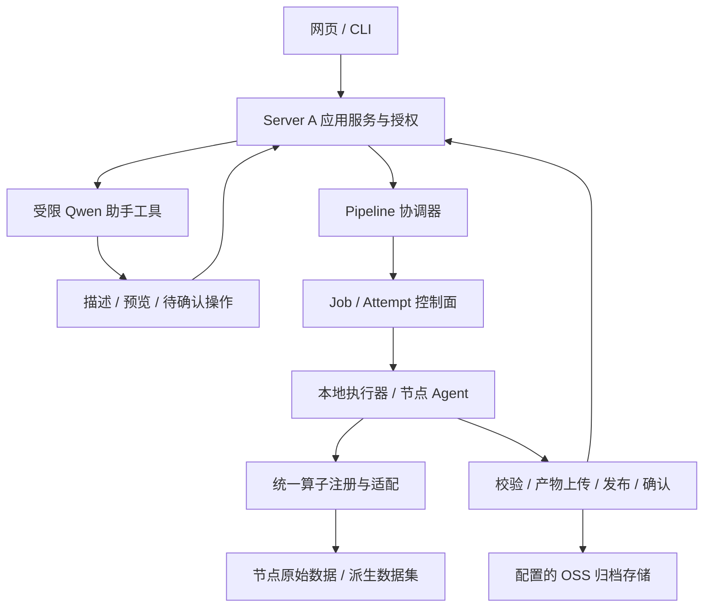

# 多服务器统一数据平台当前情况说明

> 源码能力核对：2026-10-22，含 0.3 系列异步 Runner 及本轮尚未部署的记忆和任务跟进。
> 本文描述架构与能力，不替代线上部署状态。实际版本以 dev/prod `current`、发行包、Agent 心跳和验收记录为准。
> [发行变更](data_platform_changelog.md) · [用户指南](data_platform_page_user_guide.md) · [运维手册](data_platform_operations.md)

## 架构与职责

平台采用统一控制面、节点本地计算和独立产物发布。原始数据保留在各数据服务器，
网页和 CLI 通过 Server A 的授权接口访问平台。统一目录不是共享文件系统。

- `operators/` 描述参数、输入输出、资源与节点可用能力；既有算法通过适配器接入。
- `processing/` 负责顺序流程、版本固定、计划校验、复核等待和步骤推进，复用现有 Job/Attempt。
- `console/`、`routes/` 与页面模块承接工作台功能；`viewer.py` 保留组合与共享运行状态职责。
- 节点 Agent 在允许的真实路径内执行，回报进度并发布产物；上传完成后还需控制面确认。
- 生命周期版本、lineage、Curation 草稿及审批保持各自的持久化和权限边界。

## 已实现能力

| 领域 | 当前能力与边界 |
| --- | --- |
| 数据格式 | 适配 LeRobot v2.1/v3.0，按元数据识别布局；共享 shard 的修改限制到目标 episode |
| 目录与权限 | 注册位置、按节点扫描、被动刷新；账号与环境隔离，数据范围和 Agent roots 双重校验 |
| 算子与流程 | 能力目录、参数 Schema、预览、顺序流程图、不可变版本和步骤运行；内部数据版本绑定默认隐藏 |
| 数据处理 | Viewer、Quality、Inspect、预处理、模型/媒体任务、转换及生命周期入口；以当前节点能力和预览为准 |
| 任务调度 | 节点并发槽、用户限额、资源预算、路径互斥、取消、手动重试和分阶段进度 |
| 恢复 | 计算与上传分开处理；已验证的 Viewer 产物可重试上传；MCAP 自动恢复只覆盖确认的进程丢失及有效检查点 |
| 质量与复核 | 检测产生证据和候选，人工 Keep/Exclude 与发布保持独立，不把检测标记直接当成删除决定 |
| 存储 | Viewer 缓存、结果同步、压缩 CSV、保留策略，以及已接入的 OSS 产物归档和有界读取 |
| AI 助手 | 上下文问答、补齐流程前置步骤、预览与操作卡片；用户确认后经现有服务提交 Viewer/Quality |
| 网页与 CLI | 常驻侧栏、历史恢复、显式个人偏好与长期记忆共用；已确认助手任务的终态总结可跨客户端读取；CLI 通过平台账号登录，无需个人模型密钥 |
| 部署 | 不可变发行包、开发验收、生产批准、兼容滚动升级及执行器旧代收尾 |

任务完成必须包含计算、产物发布和控制面确认。停止请求发出、操作卡片生成或服务启动，
都不能单独作为任务完成或部署成功的证据。并发上限及算子可用性属于实际配置，不从本文推断。

## 安全与数据边界

- Viewer 数据操作只读，但可以管理本人 AI 偏好与记忆；Operator 可提交授权的普通计算。
- Data manager 的源写范围与 Admin 权限独立管理。源修改还需专用入口、双端开关、确认与路径保护。
- 用户作用域限制数据读取和所有任务输入，包括 Merge 的每一个源；Agent 在领取与执行时复核。
- 普通转换生成独立输出，保留无关列、视频引用、元数据和 lineage；审批与原子发布规则不变。
- 助手只获取授权且有界的脱敏摘要，不开放任意文件、SQL、HTTP 或代码执行工具。
- 历史按账号和环境隔离，恢复时重查对象身份。偏好只影响沟通与建议，不自动训练模型或修改执行参数。
- 公共 CLI 下载只包含客户端、安装器和公开 CA；生产数据和归档凭据不因公开安装链接而开放。

详细约束见 [权限说明](data_platform_permissions.md)、[算子与助手](data_platform_operators.md)
和 [存储位置](data_platform_storage_locations.md)。

## 当前限制

- LangGraph 异步 API 与独立 Runner 已在源码实现并完成[本地验收](data_platform_assistant_langgraph.md)，运行源码默认仍为 legacy，新请求可通过服务端配置切换。
- 记忆仅显式保存，最多 20 条；任务跟进由 Runner 查询终态确认，不调用模型或产生后续任务，范围与限制见用户指南。
- 流程目前为顺序步骤，不提供任意分支 DAG；AI 自主规划执行、MCP 等不在当前承诺范围内。
- 模型、媒体、格式和算子的可用性依赖节点安装、数据字段与权限；发现能力不代表所有数据都适用。
- OSS 归档已接入，但不能由此推断所有 Viewer 缓存已迁出 Server A；缓存和归档位置以配置及发布记录为准。
- 数据版本和副本身份已有管理机制，但不等同于跨服务器透明去重、共享存储或自动副本调度。
- 自动恢复有明确适用条件；普通算法失败、取消和发布失败不会一律重新执行计算。
- Server A、数据库、网络、证书和各 Agent 仍需运维；滚动升级会有短暂网页维护，也不等同于无中断高可用。

## 实现与维护入口

| 代码或文档 | 职责 |
| --- | --- |
| [operators](../lerobot/data_platform/operators/) / [processing](../lerobot/data_platform/processing/) | 算子契约与流程编排 |
| [control_plane.py](../lerobot/data_platform/control_plane.py) / [agent.py](../lerobot/data_platform/agent.py) | 控制面与节点执行 |
| [ai_tools](../lerobot/data_platform/ai_tools/) / [CLI](../clients/data-platform-cli/) | 助手服务与终端客户端 |
| [templates](../lerobot/data_platform/templates/) | 工作台、Viewer 与助手交互 |
| [deploy/data-platform](../deploy/data-platform/) | Server/Agent 安装与升级 |
| [运维手册](data_platform_operations.md) / [发行变更](data_platform_changelog.md) | 发布步骤、影响范围和验证要求 |

每批升级在构建前同步上述文档。更改 Agent 协议、能力上报、执行或恢复逻辑时，一并更新兼容契约、
部署说明和对应验收；纯网页改动应注明无 Agent 协议变化，避免把完整包升级误解为新计算能力。

## 列表与助手操作反馈

管理审计列表按索引限量返回摘要，详情按需读取；网页统计限定最近 1,000 条匹配结果并标明范围。
本地任务先筛选后读取；远端任务列表省略执行快照，版本列表省略逐 episode 身份数组，原详情仍可用。
助手的统一操作观察服务供网页和 CLI 共用，区分已有可用结果、正在运行、尚未执行、历史待核实和失败记录；卡片提供授权结果/任务入口，默认一键确认。
支持 Viewer、Quality、阶段/标注/打标/时序标注和明确列出的单输入派生操作；复杂证据与复核流程保留原入口。
Server 按源身份、配置和已发布产物判断结果，并在提交事务内合并相同活动单操作。CLI 支持 `/open` 和 `/confirm again`；0.3.1 增加启动网页提示、`/web`、免登录 `--web` 和 `--version`，安装入口 `latest` 指向经校验的不可变客户端包。0.3.2 支持 `data-platform update` 和直接输入 `exit`/`quit` 退出。无数据库、Agent 协议或算子版本变化，Server/Agent 仍统一发布同一不可变包。

助手默认跟随页面和 Viewer Episode，服务端按授权位置读取有界的已发布 Episode 元数据，复用原始 Instruction；没有指令字段不等于没有指令文本。选中 Episode 的摘要指纹进入会话身份。网页可固定上下文，恢复历史时明确固定，切换丢弃迟到响应。操作卡片随各自消息保留，紧凑状态和可展开详情取代输入区固定面板。此变更不新增 Agent 协议或数据库表，旧 CLI API 保持兼容；按同步发行规则提供 CLI 0.3.4，面向 Server V0.3.5 验收登录、网页与授权结果跳转。

CLI 结果导航直接使用带服务地址的授权链接，常见明确网址询问走只读导航；Markdown 格式和消息级卡片在终端呈现，不改变服务端任务、权限或对话协议。
